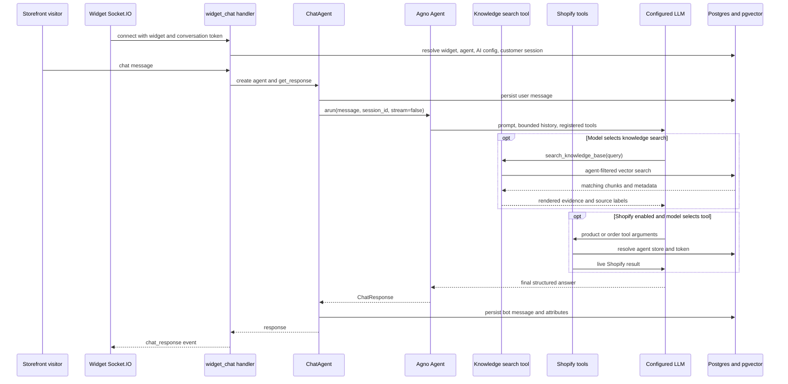
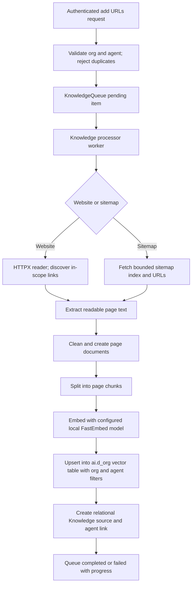
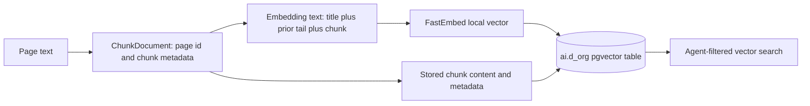
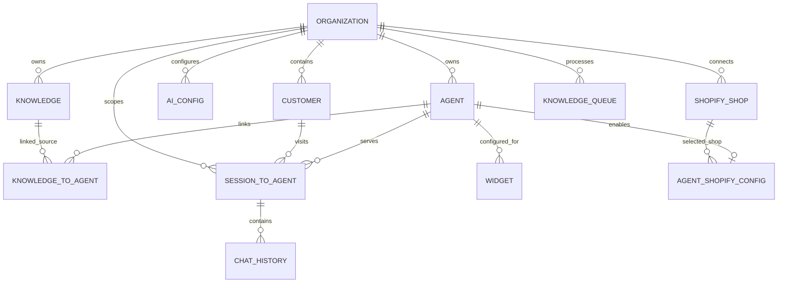
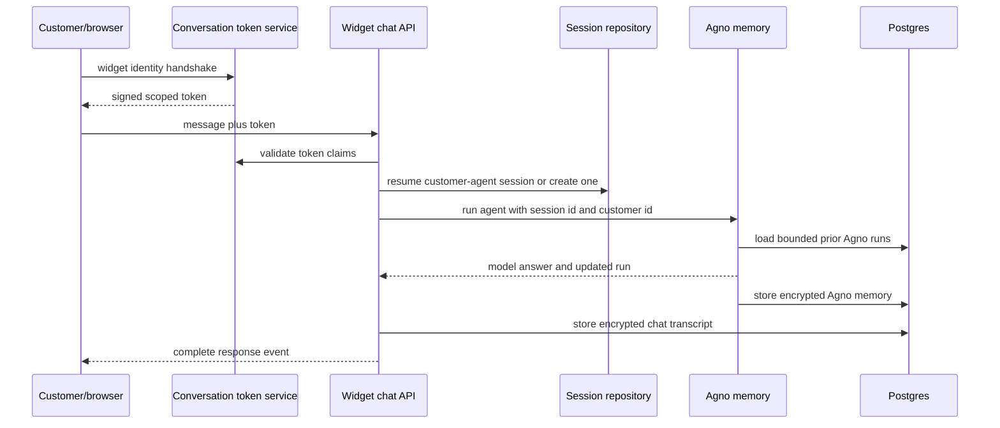
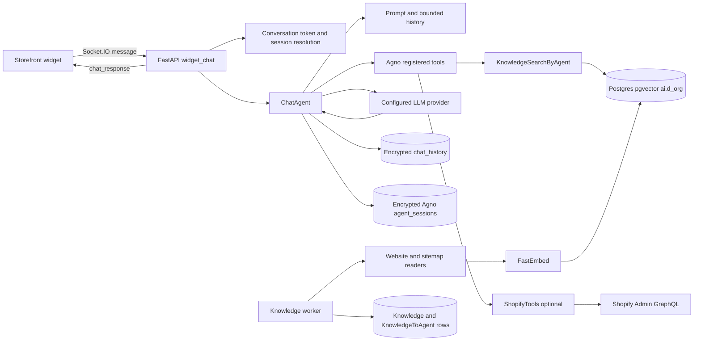

# ChatterMate Complete AI System Architecture

## Scope and evidence method

This is a static source investigation of the public checkout `upstream-chattermate` at commit `a2582a143c7a84024f2f0f5418b388dbf1cc9a15`. Findings cite repository-relative paths and line numbers from that revision. No application was started, no test was run, no external service was contacted, and no enterprise submodule was inspected. The report describes code paths, not proof of runtime correctness or answer quality.

Confidence labels: **VERIFIED** means the behavior is directly visible in locally available source; **INFERRED** means behavior follows from connected code but depends on a framework/runtime detail; **UNVERIFIED** means static inspection cannot establish it. A hypothetical customer question is illustrative only.

## 1. Executive Architecture Summary

ChatterMate's public chatbot is a FastAPI and Socket.IO application. `backend/app/api/widget_chat.py` authenticates widget conversation identity, resolves the widget and agent, opens or resumes a customer/agent session, constructs `ChatAgent`, and emits a structured response. `backend/app/agents/chat_agent.py` creates an Agno `Agent`; Agno runs the selected model and tool-call cycle. The implementation is a single configured agent with a set of enabled tools, not a custom multi-agent planner or LangGraph workflow. **VERIFIED** (`widget_chat.py:208-305,376-593`; `chat_agent.py:929-1004`).

Website knowledge is crawled into page documents, split into chunks, embedded with a local FastEmbed model, and stored in organization-specific PostgreSQL/pgvector tables. At response time the agent can call a vector-only knowledge search tool filtered by agent ID. The system does not train or fine-tune the LLM. **VERIFIED** (`knowledge_base.py:168-214`; `chunking.py:81-130`; `knowledge_search_byagent.py:89-175`).

Conversation transcript persistence and model context are distinct. Chat messages are stored in `chat_history`; Agno run/session memory is stored in `agent_sessions`, encrypted by `EncryptedPostgresAgentStorage`. Recent history is replayed with a character budget and older tool outputs stubbed. This is bounded conversational history, not semantic long-term memory or persistent user preference retrieval. **VERIFIED** (`chat_agent.py:947-973`; `history_memory.py:40-160`; `encrypted_storage.py:40-90`).

Shopify product and order functionality is supplied as opt-in LLM tools using live Shopify Admin GraphQL calls. Product results can be temporarily cached in Redis for the current organization/session and reconstructed for widget output. The Shopify access token is stored in the public `ShopifyShop` model as a string field; the inspected code does not show encryption at rest. **VERIFIED** (`shopify_toolkit.py:150-205,301-460,599-820`; `models/shopify/shopify_shop.py`).

Prompt rules request concise, grounded answers, but source inspection does not show a deterministic evidence verifier, a retrieval score threshold, or a guaranteed refusal when evidence is weak. Guardrails include input/output checks and code-owned prompt policy; model compliance remains probabilistic. No benchmark has been run. **VERIFIED** (`chat_agent.py:604-618,922-943,1351-1606`; `utils/guardrails.py`; `agents/guardrail_policy.py`).

## 2. Complete Source File Map

| Area | Source files and principal symbols | Responsibility |
|---|---|---|
| Widget handshake and chat | `backend/app/api/widget.py:get_widget_data`; `backend/app/api/widget_chat.py:widget_connect,handle_widget_chat` | Widget metadata/token handshake, Socket.IO session setup and chat dispatch |
| AI assembly and response | `backend/app/agents/chat_agent.py:ChatAgent.__init__,create_async,_arun,get_response,_store_bot_message` | Agent config, prompt, tools, model, structured response, guardrail and persistence |
| Model provider selection | `backend/app/utils/agno_utils.py:create_model` | Provider-specific Agno model construction |
| History bounds | `backend/app/agents/history_memory.py:BoundedHistoryMemory,bound_history,run_with_overflow_recovery` | Transcript replay cap, tool-result stubbing, overflow retry |
| Encrypted model session | `backend/app/agents/encrypted_storage.py:EncryptedPostgresAgentStorage` | Encrypt/decrypt Agno session memory around Postgres storage |
| Knowledge tool | `backend/app/tools/knowledge_search_byagent.py:KnowledgeSearchByAgent.search_knowledge_base` | Agent-filtered vector lookup and page/chunk context assembly |
| Knowledge source manager | `backend/app/knowledge/knowledge_base.py:KnowledgeManager.add_websites` | Source rows, agent links, crawler/vector setup |
| Crawl and parse | `backend/app/knowledge/enhanced_website_kb.py:EnhancedWebsiteKnowledgeBase`; `enhanced_website_reader.py:EnhancedWebsiteReader`; `sitemap_reader.py`; `sitemap_parser.py` | URL discovery, extraction, crawl limits and sitemap traversal |
| Chunk and embedding | `backend/app/knowledge/chunking.py:split_text,chunk_page`; `embedder.py:CachedFastEmbedEmbedder,get_embedder` | Page chunk generation and local embedding |
| Vector persistence | `backend/app/knowledge/optimized_pgvector.py:OptimizedPgVector.insert,upsert` | Organization table and pgvector document writes |
| Queue and worker | `backend/app/api/knowledge.py:add_urls`; `backend/app/workers/knowledge_processor.py:process_queue_item,run_processor` | Authenticated enqueue and background ingestion |
| Chat storage | `backend/app/repositories/chat.py:create_message,get_session_history`; `models/chat_history.py:ChatHistory` | Encrypted transcript persistence/readback |
| Session and identity | `backend/app/repositories/session_to_agent.py`; `backend/app/core/auth_utils.py`; `backend/app/services/conversation_token.py` | Customer/agent session selection and widget token checks |
| Shopify tools | `backend/app/tools/shopify_toolkit.py:ShopifyTools`; `backend/app/services/shopify.py:ShopifyService` | Product/order queries and response shaping |
| Guardrails | `backend/app/agents/guardrail_policy.py`; `backend/app/utils/guardrails.py` | Prompt policy and input/output checks |
| Core records | `backend/app/models/{agent,organization,ai_config,knowledge,knowledge_to_agent,session_to_agent,chat_history,customer,knowledge_queue}.py`; `backend/app/models/shopify/*.py` | SQLAlchemy relational schema |

## 3. AI Engine Technology Stack

**VERIFIED.** FastAPI API routes and Socket.IO widget messaging lead to a Python `ChatAgent`. `agno==1.7.6` is declared in `backend/requirements.txt`; `ChatAgent` uses Agno `Agent`, `Toolkit`, `Memory`, `PostgresAgentStorage`, and `PgVector`. No LangChain/LangGraph dependency is used for the standard customer chat path. The Agno library performs provider tool-call continuation; app code registers tools and bounds calls (`chat_agent.py:950-973`).

Provider selection is centralized in `backend/app/utils/agno_utils.py:create_model` (lines 53-178): OpenAI and enterprise `CHATTERMATE`, OpenAI-compatible endpoints, Anthropic, DeepSeek, Google/Gemini and Vertex, Groq, Mistral, Hugging Face, Ollama, and xAI branches are present. Availability still depends on provider SDKs, valid configuration and credentials. `CHATTERMATE` uses hosted/enterprise-specific behavior and should not be treated as a self-hostable provider. The application encrypts configured API keys in `AIConfig.encrypted_api_key` (`models/ai_config.py:23-67`).

Embedding is separate from answer generation: `CachedFastEmbedEmbedder` loads the configured FastEmbed model once per process (`knowledge/embedder.py:33-59`); the default model is configured in `backend/app/core/config.py` as `BAAI/bge-small-en-v1.5`. Answer generation uses the selected provider/model, which is not the embedding model.

## 4. Customer Message Execution Flow

The normal widget path is directly traceable, though actual model decisions and provider behavior are runtime-dependent.

1. `widget_connect` in `api/widget_chat.py` validates the conversation token and widget/org/customer claims, looks up `Widget`, active `AIConfig`, agent, and customer/agent session. It snapshots provider/model settings and identity into Socket.IO state.
2. `handle_widget_chat` applies rate limiting and sanitization, verifies the live session identity, and branches for workflow, human takeover, disabled AI, or normal AI handling.
3. Normal path constructs `ChatAgent.create_async(...)`, decrypting the org API key and passing the agent/org/customer/session/channel context. Shopify and MCP integrations are only attached if configured.
4. `ChatAgent.get_response` applies inbound guardrails, persists the user message, then calls `_arun`. Agno loads the configured conversation session/history and exposes registered tools.
5. If the model decides to call `search_knowledge_base`, the tool retrieves linked source metadata and queries pgvector using the agent filter. If Shopify is enabled, product/order tools are also available. Tool selection is model-driven within the app's deterministic enablement and limit controls.
6. Agno continues the model turn with tool results and returns structured `ChatResponse`. App code parses/salvages provider output, applies output guardrails, handles transfer/end/lead/ticket data, and enriches Shopify product outputs from Redis where applicable.
7. Bot response is persisted, then emitted as a complete `chat_response` event with message/action/citation fields. The model call uses `stream=False`; a typing event is not token streaming.

**Example is hypothetical:** “Do you have black running shoes below 2000?” No configured merchant, catalog, currency, model, or tool decision is available in this static review. If Shopify is enabled, `search_products` is registered and accepts query/price filters; the model may choose it. Otherwise, the model may request knowledge search or answer from existing context. Source does not guarantee that it will select the right source or return a correct result.

## 5. Website Crawling & Ingestion

### Source-backed path

`POST /knowledge/add/urls` in `backend/app/api/knowledge.py:add_urls` validates the authenticated user's organization, checks agent ownership/knowledge permission and duplicate source records, performs URL safety checks, creates `KnowledgeQueue` records, and returns without doing the full crawl in the request. `backend/app/workers/knowledge_processor.py:run_processor,process_queue_item` polls the queue and invokes `KnowledgeManager.process_knowledge`.

`KnowledgeManager.add_websites` in `backend/app/knowledge/knowledge_base.py:168-214` creates `EnhancedWebsiteKnowledgeBase`, configures the org-specific vector table, then loads site pages with filters for source name, `agent_id`, and `org_id`. Successful ingestion creates a `Knowledge` source record and a `KnowledgeToAgent` link. Sitemap requests use `SitemapReader` and `sitemap_parser.py`; normal website requests use `EnhancedWebsiteReader`.

The reader uses HTTPX and BeautifulSoup, discovers internal links from anchors with bounded depth/link count and crawl scope, normalizes URLs, skips non-page/query patterns, and has an optional Crawl4AI/Chromium fallback for JavaScript-heavy/challenge pages. It removes script/style/noscript/iframe/head and comments, then extracts page content with fallbacks. Page failures are retried/recorded and skipped; a run storing no documents raises a failure rather than silently succeeding (`enhanced_website_kb.py:_raise_if_nothing_stored,load`). Sitemap parsing supports URL sets, indexes, gzip, bounded recursion, URL count, and domain checks (`sitemap_parser.py:160-219`). Exact defaults are in reader/settings: depth, per-source links, workers, content minimum, timeout, retries, plus queue-level plan limits; see `backend/app/knowledge/enhanced_website_reader.py` and `backend/app/core/config.py`.

### Extraction and limits

**VERIFIED.** Chunking in `backend/app/knowledge/chunking.py:81-130` uses a character target (`KNOWLEDGE_CHUNK_SIZE`, default 1100) and chooses paragraph, newline, sentence, then word boundaries; chunks are disjoint slices. `chunk_page` adds title and tail of previous chunk to *embedding text*, while stored body remains the exact chunk. Overlap configuration is 120 chars where the chunk/page helper uses it; it is contextual embedding overlap, not duplicated stored text. Minimum fill is 30% of target before taking a separator.

The crawler stores textual page content. It does not create a normalized product catalog from website HTML: no structured schema for product variants/prices/images was found in this ingestion path. Shopify product data is a separate live tool path. JavaScript rendering is optional fallback, not guaranteed for all pages. It is not a browser-first crawler. Duplicate handling uses the source/page name and vector IDs; `skip_existing` prevents recrawling already-known pages by default. A same-source add is rejected at API level. No recurring sync scheduler was found. Manual edit/delete paths exist in `api/knowledge.py` (`delete_knowledge`, `update_chunk_content`, `delete_chunk`, `update_page_content`, `delete_page`) and vector link synchronization is in `services/knowledge_vector_links.py`.

### Security and failure behavior

`backend/app/knowledge/url_safety.py:guard_url,safe_get,safe_stream` rejects private/internal resolved addresses and validates every manually followed redirect. Sitemap fetching also uses URL guards and caps. However `EnhancedWebsiteKnowledgeBase.set_reader` explicitly constructs the reader with `verify_ssl=False` (`enhanced_website_kb.py` around lines 90-105), weakening TLS authenticity for page fetching. The optional browser fallback has a different network surface; verify its egress controls before production. DNS rebinding/TOCTOU, redirects, browser traffic, resource exhaustion, and parser edge cases require dedicated security tests. Static code cannot prove runtime protection.

**Not model training:** ingestion creates searchable document embeddings; it does not alter LLM weights. It is retrieval-based indexing.

## 6. Knowledge Processing

The ingestion data path is `URL -> queue row -> reader documents -> page chunker -> local embedder -> pgvector upsert -> relational source/agent link`. `EnhancedWebsiteKnowledgeBase.load` initializes an embedding queue/thread pool when `ENABLE_IMMEDIATE_EMBEDDING` is enabled; failures are logged and unsuccessful documents may be skipped. `_raise_if_nothing_stored` converts an empty successful-looking crawl into an explicit failed job. Queue processing records status, error, stage/progress, and notifies through configured notification infrastructure (`models/knowledge_queue.py`; `workers/knowledge_processor.py`).

FAQ generation/import exists as a separate service path, not the core retrieval mechanism (`services/faq_article_import.py` and worker flow). It should not be confused with a guarantee of automatic FAQ synthesis for every crawl. The page content remains textual and source metadata supports page references/citations.

## 7. Embedding & Vector Storage

`get_embedder()` returns `CachedFastEmbedEmbedder`; it uses FastEmbed/ONNX with a process-cached `TextEmbedding` object (`knowledge/embedder.py:23-59`). Default model is `BAAI/bge-small-en-v1.5`; its 384-dimensional vectors are compatible with the declared vector configuration. Embedding generation is local after model assets are available; first use may require obtaining model artifacts, which was not attempted here.

`KnowledgeManager` selects schema `ai` and table `d_{organization_id}` (`knowledge/knowledge_base.py:72-101`). `OptimizedPgVector` stores document ID, name, metadata JSON, filters, content, embedding, usage, and content hash; it upserts on ID and commits batches (`knowledge/optimized_pgvector.py:insert,upsert`). It uses pgvector and configured index settings including HNSW/cosine for the write-side vector table. Search explicitly requests vector mode. The SQLAlchemy application models do not define one ORM row per vector chunk; Agno/PgVector creates and operates this dynamic vector table.

## 8. Database Model & Relationships

Key SQLAlchemy models and relationships below are those visible in public models. Vector rows are separate dynamic Agno tables.

| Model/table | Relevant fields and relationships | Isolation/notes |
|---|---|---|
| `Organization` (`models/organization.py`) | UUID identity, name/domain/settings; parent for agents, customers, AI config, knowledge and Shopify shop | Organization ID is core tenant boundary |
| `Agent` (`models/agent.py`) | UUID, `organization_id`, instruction/configuration fields, active/workflow/transfer/tool flags | Agent belongs to org; instructions persisted as text/JSON-backed property |
| `AIConfig` (`models/ai_config.py:23-67`) | org FK, model type/name, encrypted API key, settings, active flag | One active config is selected per org in repository logic |
| `Knowledge` (`models/knowledge.py`) | integer ID, source, source type, schema/table, organization FK, timestamps | Source metadata, not document content |
| `KnowledgeToAgent` (`models/knowledge_to_agent.py`) | knowledge FK, agent FK, timestamps | Relational mapping authorizes linked sources; inspect DB migrations for deployed uniqueness details |
| `KnowledgeQueue` (`models/knowledge_queue.py:37+`) | org/agent/user IDs, source type/source, status/error/metadata/priority/stage/progress and timestamps | Queue indexed for org/status; worker status visible to dashboard |
| `Customer` (`models/customer.py:33+`) | UUID, org FK, email/name/phone, metadata/authentication/lead fields | Email+org uniqueness; phone partial uniqueness where configured |
| `SessionToAgent` (`models/session_to_agent.py:43+`) | session UUID, user/customer/agent/org IDs, status/channel, assignment, summary and workflow state | Active session lookup is customer+agent scoped; org/session identity checked on chat path |
| `ChatHistory` (`models/chat_history.py:23-70`) | message ID, org/customer/agent/session refs, encrypted message, type, attributes, sentiment, timestamp | Session/time index; transcript row model |
| `Widget` (`models/widget.py`) | widget ID, organization and agent refs | Public widget lookup resolves assigned agent |
| `ShopifyShop` (`models/shopify/shopify_shop.py:25+`) | organization, domain, access token, installation state | Token field appears plaintext at model level |
| `AgentShopifyConfig` (`models/shopify/agent_shopify_config.py:23+`) | agent, shop, enabled | Tool requires enabled config and same-org shop check |
| `agent_sessions` (Agno storage) | Agno session/memory record; created via `EncryptedPostgresAgentStorage` | Not a SQLAlchemy model in app; wrapper encrypts `memory` payload |
| `ai.d_{org}` (pgvector) | Agno document `id,name,meta_data,filters,content,embedding,usage,content_hash` | Organization-specific table plus agent filter during search |

The dynamic vector-table relationship to organization and agent is expressed in JSON filters (`org_id`, `agent_id`) rather than a conventional FK to each chunk. `KnowledgeSearchByAgent` first resolves linked sources by agent, then searches the organization table with `agent_id` filters and optional source name. Deletion/link changes must keep vector metadata and relational links synchronized; inspect `services/knowledge_vector_links.py` and knowledge deletion endpoints for that lifecycle.

## 9. RAG Retrieval Algorithm

`KnowledgeSearchByAgent` (`backend/app/tools/knowledge_search_byagent.py:57-175`) registers `search_knowledge_base(query, source?)`. It resolves all sources linked to the agent; obtains the first source's org table/schema; constructs Agno `PgVector` with `SearchType.vector` and the configured embedder; then searches using `agent_id` and optional source-name filters. The query is the tool argument provided by the LLM. No explicit query rewriting, conversation-aware standalone-question builder, or lexical search is implemented in this tool.

The default result count is `KNOWLEDGE_SEARCH_RESULTS` (default 6); it increases by already-seen chunk count to find alternatives after suppressing repeats in a turn. There is no app-level similarity cutoff or reranker in this call. Underlying Agno/PgVector performs vector similarity and ranking; the exact SQL score transformation is delegated to that dependency. Search results are grouped by page and adjacent chunks/head chunks may be fetched to restore context; rendered content is capped by `KNOWLEDGE_SEARCH_MAX_CHARS` (default 15,000). Citation payloads retain names/types and URLs/page labels where available, but no independent source verifier is run.

Multiple linked knowledge sources can be searched together in the org table. A source filter can narrow a call. Product website content and policy text can therefore co-occur as plain textual evidence if both were ingested and retrieved. The code does not explicitly perform evidence reconciliation across documents. Hybrid BM25/vector retrieval, reranking, contextual query rewriting, score calibration, MMR, answer citation validation, token-aware context budgeting, and factual post-check are not shown in the application path.

**No-result behavior:** the model is instructed to admit missing facts and can use no-result tool output; there is no deterministic “score below threshold, refuse” gate evident in this retrieval path. Relevance and truth remain model-dependent. Failure modes include wrong query argument, multilingual embedding mismatch, page extraction/chunk boundary loss, source filter mismatch, low-quality vector neighbors, missing/stale pages, and unsupported synthesis.

## 10. LLM Prompt Construction

The standard `ChatAgent` system message is assembled in `backend/app/agents/chat_agent.py:584-927`:

1. Agent dashboard instructions are wrapped as operator-authored text; knowledge tool usage and scope prompt are appended outside that fence. For a workflow custom system prompt, the custom prompt takes that branch instead of normal agent instructions/knowledge scope.
2. Code-owned guidance asks for concise 2–4 sentence answers, bounded tool use, no repeated failed calls, exact reproduction of known URLs/contact/prices, and admission/escalation when details are absent (`:604-618`).
3. Transfer, lead capture, ticketing, Shopify, MCP, channel quick replies, and per-conversation context instructions are conditionally appended (`:622+`, `:650+`, `:880-920`). Shopify prompt specifically instructs asking for order number plus checkout email and only using email entered in the chat (`:880-885`).
4. `apply_guardrail_policy` prepends code-owned policy and a precedence anchor (`:922-927`). `guardrail_policy.py` includes instruction hierarchy and treatment of customer/visitor content as untrusted.
5. `create_model` selects provider and output limits (`:929-943`). Agent receives the assembled system message, tool set, bounded history, and structured output schema (`:945-973`).

Agent instructions and workflow instructions are tenant/operator-controlled; platform grounding, tool-use, and guardrail policy are code-owned. Tool descriptions come from registered tool definitions. Conversation messages are separately included by Agno history settings. Customer language is not detected by a dedicated NLU module; language matching is an emergent model behavior based on prompt and context. No explicit fixed sampling temperature was identified as a universal app setting; provider defaults or per-model settings may apply.

Grounding is instruction-level. It asks the model not to invent and to cite from retrieved/tool/config data, but does not prove that claims are entailed by evidence. No post-generation fact checker is present in the examined response path.

## 11. Natural Conversation Logic

Natural language is produced by the configured general-purpose LLM, constrained by system prompt, previous turns, structured response schema, and tools. There is no distinct intent classifier/NLU engine on the ordinary chatbot path. The model can interpret follow-up references through recent replayed messages; application code also injects known identity for lead/ticket flows and deterministic state for workflow/handoff branches.

Prompt requests concise answers and question clarification when required. Tool errors are intended to stop repeated calls. Greeting behavior has a knowledge-tool prompt exception so general greetings do not trigger retrieval. Transfer and ticketing are conditional structured actions. These are model instructions and configuration, not fully deterministic policy enforcement in every answer. Hard-coded text exists for failures, blocked input and some workflow/handoff cases; normal answers are model generated.

## 12. Conversation Memory Architecture

`SessionToAgentRepository.get_active_customer_session(customer_id, agent_id)` resumes an active customer/agent session, or `widget_connect` creates a UUID session. Widget identity is bound to signed conversation tokens and widget/organization/customer claims (`api/widget.py:get_widget_data`; `api/widget_chat.py:widget_connect`; `services/conversation_token.py`). The token service has bounded expiry/rotation/revocation behavior; session identity is not inferred from arbitrary browser text.

On each run, Agno storage loads the session for the session/user identity and `BoundedHistoryMemory` returns recent runs. `num_history_responses` is configured to five and `AGENT_HISTORY_MAX_CHARS` caps total replayed text. Earlier tool messages become a stub, whole oldest turns are dropped, and the newest complete turn is kept if it fits. If provider signals context overflow, `run_with_overflow_recovery` retries once without replayed history, within remaining timeout (`history_memory.py:40-160`).

Agno memory is encrypted by `EncryptedPostgresAgentStorage` on upsert and decrypted on read. If decryption fails, the run continues without history. Chat transcript remains separately saved in encrypted `ChatHistory.message` for inbox/history display. The examined LLM prompt path uses Agno session history; no explicit full transcript-to-prompt reconstruction from `ChatHistory` was found.

What it remembers: bounded recent conversational turns for the same active session, including assistant/tool traces (older tool results stubbed). What it does not show: semantic cross-session retrieval, durable preference profile, customer-specific long-term memory, automated summarization, or guaranteed cross-device continuity. Session expiry and deletion/retention should be validated in deployment. Concurrent turns on the same session may race unless runtime/storage locking handles them; no app-level per-session serialization was established here.

## 13. Agent Reasoning & Tool Calling

Tool definitions are Python functions registered into Agno `Toolkit`s. The standard agent combines knowledge search, optional Shopify, optional Jira/ticket, and MCP tools. `tool_call_limit` is configured from settings (default 5); the agent has a 90-second default run timeout (`AGENT_RUN_TIMEOUT`), with one context-overflow retry. Agno manages model-request/tool-result/model-continuation orchestration; application code is not a general autonomous planning loop.

The model decides whether to invoke an exposed tool and supplies arguments. The application deterministically controls whether a tool is exposed, injects tenant/session IDs into tool instances, verifies some integration scope, and handles results/errors. Tool failures usually return a string/JSON error to the model; prompt says stop after errors. Retry policy is not a universal automatic retry; external service functions vary. Tool permission enforcement depends on tool-specific code and should be reviewed individually.

The structured `ChatResponse` includes message plus action flags/metadata for transfer, end chat, citations, lead and Shopify outputs (`models/schemas/chat.py:217+`). Structured output improves shape, not factual accuracy. Groq follows a special JSON-tool path because its provider cannot combine the same response-format and tools mode (`chat_agent.py:955+`).

## 14. Shopify Intelligence Tools

`ChatAgent` attaches `ShopifyTools` only when the agent's Shopify configuration is enabled and the run is eligible. Tool registration includes `list_products`, `get_product`, `search_products`, `search_orders`, `get_order_status`, and `recommend_products` (`tools/shopify_toolkit.py:150-170`). `_get_shop_for_agent` loads the configured shop and checks `is_installed` plus `shop.organization_id == org_id` (`:175-205`).

Product tools call `ShopifyService` or Shopify Admin GraphQL live, not a periodically synchronized local product database. Queries expose titles, description, vendor/type/tags, price ranges, inventory, product image and variant data where selected by GraphQL. Search accepts query, limit, cursor, min/max price, and vendor (`:363+`). Product results can be reduced for LLM use and the full data cached in Redis under `{org_id}:shopify_products:{session_id}`; the cache path is per-turn/session and short-lived, and backend output enrichment reads that cache (`:150-205` and `ChatAgent` response enrichment).

Order tools search Shopify GraphQL with customer email and optional order number; `get_order_status` requires both order number and email and checks the returned order identity/number using helpers in `tools/shopify_order_access.py`. This is an email-and-order-detail check, not proof of authenticated Shopify customer identity. The prompt says to request both values and only use email typed in chat. Do not expose sensitive order/shipping information without a separately reviewed identity verification design.

No local product synchronization pipeline or product vector ingestion was established in the AI tool path. Store policy data is not a dedicated tool in the registered list; it may be available only if public website policy pages are crawled into text knowledge. Webhook/install lifecycle and OAuth are separate Shopify integration paths, not the AI reasoning engine. Token storage appears plaintext in `models/shopify/shopify_shop.py`; this is a security blocker before connecting a real store. **VERIFIED; runtime Shopify behavior unverified.**

## 15. Response Generation & Streaming

`ChatAgent._arun` uses `agent.arun(..., stream=False)` with `AGENT_RUN_TIMEOUT`; output is parsed to `ChatResponse`, with provider-specific recovery/salvage logic in `utils/response_parser.py` and `chat_agent.py`. `get_response` stores the user's message before model execution, applies output guardrails, post-processes actions/citations/Shopify output, and stores bot response. Exceptions produce a generic failure response and are logged (`chat_agent.py:995-1060,1346-1606`).

Widget uses Socket.IO for real-time transport, but the model result is sent as a complete event after generation. Typing indicators are not model token streaming (`api/widget_chat.py:807-841`; `history_memory.py:122`).

## 16. Grounding & Hallucination Controls

Controls present: code-owned prompt asks not to invent specifics and to state when evidence is absent; knowledge tool returns source names/URLs; agent instructions describe when to search; inbound/output guardrail checks; visitor-provided content is treated as untrusted by prompt policy; response schema constrains output fields; tool execution is bounded.

Controls absent or not established: score threshold, evidence entailment checker, citation-required validator for every factual claim, deterministic no-answer rule, independent price/inventory freshness check after generation, robust prompt injection isolation at retrieval/tool output level, or benchmark-based accuracy assurance. Retrieved page text and external tool data are still model context. Prompt injection rules reduce risk but do not create a hard security boundary by themselves.

## 17. Security & Tenant Isolation

- Widget path validates scoped conversation token and binds widget/org/customer/session (`api/widget_chat.py`; `core/auth_utils.py`; `services/conversation_token.py`). **VERIFIED**, though deployment secret/rotation and browser threat tests remain needed.
- Knowledge API checks permission and org/agent ownership before queueing; vector search derives sources for agent and filters `agent_id`; org-specific table adds another boundary (`api/knowledge.py:add_urls`; `knowledge_search_byagent.py`). Validate all link/delete endpoints and database constraints under adversarial multi-tenant tests.
- Chat and agent memory are encrypted using application encryption types/wrappers (`models/chat_history.py`; `agents/encrypted_storage.py`). Key management, rotation, and backups remain operational responsibilities.
- Shopify token field is not encrypted at model level; token is sent in `X-Shopify-Access-Token`. Store/agent/org matching is checked in tool retrieval. **Security remediation required before real Shopify credentials.**
- Crawler has strong URL checks and per-redirect validation in `url_safety.py`, but knowledge reader sets `verify_ssl=False`; optional browser fallback needs egress review. Resource limits and DNS resolution behavior require runtime testing.
- Prompt injection protection is partly pattern/guardrail and prompt-based; retrieved pages and customer inputs remain untrusted content. Tool authorization must remain server-side and not be delegated to model instructions.
- No CVE database/network advisory lookup was performed in this source-only task; this section is code-level risk review, not an assertion that a known advisory affects this exact commit.

## 18. Background Workers & Synchronization

Knowledge ingestion runs outside the web request through `KnowledgeQueue` and `knowledge_processor.py`; configured polling and parallel item limits are implemented there. Embedding can run in worker threads during ingestion. FAQ and notification processing are ancillary. No recurring website recrawl/sync schedule was found. Manual update, page/chunk edit, unlink and delete routes are present; exact deletion behavior should be checked against dynamic vector table filters to ensure no orphan vectors.

## 19. Important Configuration Parameters

Exact env names/defaults should be checked in `backend/app/core/config.py` and `backend/.env.example` for the chosen deployment. Static defaults relevant to AI include:

| Parameter | Role / observed default |
|---|---|
| `FASTEMBED_MODEL` | Local embedding model; default `BAAI/bge-small-en-v1.5` |
| `KNOWLEDGE_CHUNK_SIZE` | Character chunk target; default 1100 |
| `KNOWLEDGE_CHUNK_OVERLAP` | Embedding context overlap; default 120 |
| `KNOWLEDGE_SEARCH_RESULTS` | Vector results; default 6 |
| `KNOWLEDGE_SEARCH_MAX_CHARS` | Rendered retrieval context cap; default 15000 |
| `AGENT_HISTORY_MAX_CHARS` | Bounded history replay character budget |
| `AGENT_RUN_TIMEOUT` | Agent run timeout; default 90 seconds |
| Agent tool-call limit | Default 5 in agent construction/settings |
| Reader depth/link/timeout/retries/workers | Reader/settings defaults in `enhanced_website_reader.py` and `core/config.py`; source-specific plan limit can override max links |
| `ENABLE_IMMEDIATE_EMBEDDING`, `EMBEDDING_MAX_WORKERS` | Ingestion embedding concurrency |
| `VERIFY_SSL_CERTIFICATES` | Shopify HTTP TLS verification setting; crawler reader separately passes `verify_ssl=False` |
| `OUTBOUND_URL_POLICY` | Outbound model endpoint policy; `.env.example` shows `any`, review before self-hosting |

The provider API key/model name, database, Redis, encryption key, queue, and token settings are deployment-specific. Never copy defaults or secrets from an example file into production.

## 20. Five Architecture Diagrams

### Diagram 1 — Complete AI system architecture

### Diagram 2 — Website learning pipeline

See the source-backed flow in section 5. A URL enters an authenticated queue, then reader and chunk/embedding workers write page chunks and finally link a knowledge source to the agent. This is indexing, not training.

### Diagram 3 — Customer chat execution

See the Mermaid sequence in section 4. The model may choose tools; only enabled tools are exposed. The response is non-streamed and persisted before the widget event.

### Diagram 4 — Conversation memory

See the sequence in section 12. Signed widget identity resolves a session; Agno history is bounded/encrypted; the separate ChatHistory transcript supports conversation display.

### Diagram 5 — Database relationships

See the ER diagram in section 8. Dynamic vector rows are org tables with agent metadata filters, not a conventional ORM FK relation.

## 21. Algorithm-Level Reimplementation Blueprint

This is a technology-neutral reconstruction of implemented behavior, not a claim that direct translation preserves semantics.

| Subsystem | Responsibility, data contract and source-backed algorithm | Storage/dependencies and boundaries | Errors, performance and verification |
|---|---|---|---|
| Website ingestion | Accept authenticated org/agent plus HTTPS website or sitemap; dedupe source; enqueue; worker discovers bounded pages, extracts text, creates page documents | Queue with tenant IDs; HTTP client, parser, optional browser; URL resolver must block private IPs and revalidate every redirect | Retry page failures; fail empty ingestion; verify SSRF, robots/scope, limits, and queue recovery |
| Knowledge source linking | Store source metadata and link source to agent after ingest; retain org and agent identity in vector metadata | Relational source/link rows plus org-scoped vector table | Transactions or repair process needed if vectors succeed but relational link fails; test unlink/delete cleanup |
| Chunking | Split readable page text into ordered bounded chunks at paragraph/newline/sentence/word; store exact content, ID by page+ordinal; embed title and previous tail as context | Chunk metadata includes page ID/index/count; character-target differs from tokens | Verify boundary reconstruction, tables/lists, multilingual pages, and embedder limits |
| Embedding pipeline | Compute deterministic vector per chunk using a local model; batch upsert | Vector DB, model artifact cache, model/version/dimension metadata should be explicit in a new system | Retry per chunk; surface partial failure; measure throughput and re-embedding compatibility |
| Vector retrieval | Accept tool query; select only agent-linked sources; apply tenant+agent filters; vector top-k; restore nearby chunks; cap rendered text | PostgreSQL/pgvector or equivalent; vector index; metadata filters | No score threshold/reranker in source pattern; test recall, contamination, score calibration, no-result handling |
| Agent orchestration | Build system prompt from platform policy, merchant instructions, channel/state; provide selected model and enabled tools; run bounded tool loop | LLM provider abstraction; tenant config; tool registry | Enforce timeout/tool-call budget and authorization in server code; test malformed tool args/provider errors |
| Tool calling | Expose typed function schemas; model chooses; server validates args and tenant identity; call business service; return structured result | Tool adapters isolate credentials and external APIs | Timeout, rate limits, idempotency, redaction, audit; test repeated calls and unauthorized IDs |
| Conversation memory | Resolve signed customer/session identity; load recent complete turns within character/token budget; truncate/stub older tool output; persist transcript and model session separately | Relational transcript plus encrypted agent-run store | Session race, expiry, encryption rotation, retention, overflow retry; test refresh and concurrent requests |
| Natural responses | Send instructions + history + evidence + tool results to general LLM; ask for concise grounded response and structured action fields | Provider/model configuration and response schema | Prompt instructions do not enforce truth; add evaluation and deterministic validation where needed; measure language, accuracy, latency |
| Shopify data access | Expose live catalog/order functions only for configured store; verify store belongs to agent tenant; return minimal LLM result; optionally cache full product output | Encrypted token vault required; Admin API version/scopes/webhooks configured per app | Never treat order email as strong auth; verify ownership, scopes, uninstall revocation, HMAC, rate limits, freshness |
| Grounding/fallback | Include retrieval/tool sources and ask model to state missing details; attach source references | Persist retrieved source IDs and claim-to-evidence if stronger audit is required | Source implementation lacks evidence entailment; verify no-answer behavior and unsupported claim rate |

Suggested contracts: `KnowledgeSource(orgId, agentId, sourceType, canonicalUrl, syncState)`, `Page(pageId, sourceId, url, title, fetchedAt, contentHash)`, `Chunk(chunkId, pageId, ordinal, text, embedding, metadata)`, `Conversation(orgId, agentId, visitorId, sessionId)`, `Message(role, content, toolCall?, sourceRefs?, createdAt)`. These are blueprint contracts, not exact ChatterMate schema. A new implementation should version embedding model, dimensions, chunker and prompt/tool schemas, and should isolate external calls behind tenant-scoped services.

### Apache-2.0 and dependency licenses

The checked-out public source has Apache License 2.0 notices. If adapting/copying code, retain applicable copyright/license headers, include the Apache-2.0 license and required NOTICE contents, mark modified files, and preserve upstream attribution. Review each dependency and asset's separate license; Apache source licensing does not relicense dependencies, logos, trademarks, or unavailable enterprise modules. This report does not replace legal review.

## 22. Known Limitations & Missing Capabilities

- **VERIFIED:** Vector-only RAG tool; no application-level lexical/hybrid retrieval, query rewriting, reranker, score cutoff, or deterministic evidence check identified.
- **VERIFIED:** Retrieval is optional/model-selected during the agent turn; prompt tells it when to search, but no guarantee every factual query triggers it.
- **VERIFIED:** bounded recent chat history only; no durable semantic memory or explicit preferences store in the AI prompt path.
- **VERIFIED:** website ingestion is textual; structured product extraction from arbitrary HTML is absent in this path.
- **VERIFIED:** no recurring crawl/update scheduler found; manual source lifecycle endpoints exist.
- **VERIFIED:** Shopify catalog/order tools make live API calls; no local synchronized catalog established; order email+number is not strong customer authentication.
- **VERIFIED:** Shopify token field is plaintext at ORM layer; TLS verification setting should be reviewed; crawler reader explicitly disables certificate verification.
- **VERIFIED:** response is not streamed token-by-token.
- **INFERRED:** accuracy is sensitive to provider, model, prompt, embedding quality, page extraction, tenant configuration and external API freshness.
- **UNVERIFIED:** actual retrieval relevance, multilingual quality, latency, cost, browser fallback success, multi-tenant isolation under load, and actual Shopify API compatibility. No response-quality benchmark was executed.
- **UNVERIFIED:** exact operational retention/deletion behavior for every Agno session and vector-table row without inspecting production DB migrations/runtime.

## 23. Risks & Assumptions

The report assumes the local checkout corresponds to the named audited revision; it does, as checked from Git HEAD. Enterprise submodules are outside scope and unavailable. Provider SDKs, model credentials, Redis, PostgreSQL/pgvector, Shopify configuration and frontend widget deployment are runtime dependencies. Framework behavior attributed to Agno/PgVector follows the public call/configuration; internal dependency implementation was not independently executed. The source's configured behaviors can differ by agent, provider, workflow, channel and feature flags.

Highest risks before adaptation: plaintext Shopify token storage; crawler TLS verification disabled; uncertain order identity; prompt-based rather than deterministic grounding; lack of explicit retrieval score calibration; operationally unverified vector-link cleanup; and untested concurrency/session boundaries.

## 24. Quality Validation Requirements

No tests or model calls were run. A future controlled evaluation should establish a verified answer key for each source and include:

- Retrieval: exact evidence recall@k, relevant chunk precision, page/source correctness, no-result behavior, duplicate and stale-content behavior.
- Answer quality: evidence-supported claim accuracy, unsupported claim rate, citation correctness, refusal rate, and product price/inventory freshness.
- Conversation: follow-up resolution, context retention after refresh, repeated question handling, language consistency for English/Hindi/Hinglish, and context overflow retry.
- Security: tenant cross-read attempts, forged/expired token, session fixation, crawler SSRF/redirect/DNS cases, prompt injection in visitor content and crawled pages, tool argument tampering, Shopify token exposure and order lookup authorization.
- Reliability: worker retry and poison jobs, partial embedding failures, vector/database outages, provider timeout/rate limit, Redis outage, concurrent messages, cancellation and deletion cleanup.
- Operations: model/provider/version, embedder/version/dimensions, prompt version, retrieved source IDs, tool calls, latency and cost recorded without leaking secrets or unnecessary personal data.

Use deterministic fixtures first, then an explicitly budgeted provider evaluation. Do not infer quality from page presence or a successful HTTP response.

## 25. Technical Implementation Handoff Checklist

- [ ] Define stable tenant, agent, source, page, chunk, visitor and conversation contracts.
- [ ] Decide whether to reuse the same vector-only retrieval baseline or add hybrid retrieval/reranking based on measured tests.
- [ ] Build ingestion queue with URL canonicalization, public-IP enforcement, redirect checks, content/resource caps, retries and source lifecycle.
- [ ] Version chunking and embedding model; support re-embedding and index migration.
- [ ] Enforce organization/agent boundaries in every repository and tool service, independently of LLM-provided arguments.
- [ ] Separate operator prompts, platform policies, retrieved untrusted data, and tool outputs; test prompt injection explicitly.
- [ ] Implement bounded recent history and define cross-session memory/retention deliberately rather than assuming it.
- [ ] Encrypt provider/Shopify credentials with managed keys, rotation, audit and redaction.
- [ ] Require a stronger customer identity proof before exposing order details.
- [ ] Add factual evidence checks/citations if product requirements require guarantees beyond prompt instructions.
- [ ] Define external tool timeout, retry, idempotency, rate-limit and cancellation behavior.
- [ ] Build source-grounded multilingual evaluation and security regression suite before claiming parity.
- [ ] Review Apache-2.0 NOTICE, individual dependency/asset licenses, and enterprise exclusions before copying code.

## Appendix — First files to examine by subsystem

| Reimplementation area | First source files |
|---|---|
| Chat request and session identity | `backend/app/api/widget_chat.py`; `backend/app/api/widget.py`; `backend/app/services/conversation_token.py`; `backend/app/core/auth_utils.py` |
| Agent and prompts | `backend/app/agents/chat_agent.py`; `backend/app/agents/guardrail_policy.py`; `backend/app/models/schemas/chat.py` |
| Providers | `backend/app/utils/agno_utils.py`; `backend/app/models/ai_config.py`; `backend/app/core/config.py` |
| RAG | `backend/app/tools/knowledge_search_byagent.py`; `backend/app/knowledge/knowledge_base.py`; `backend/app/knowledge/optimized_pgvector.py` |
| Crawler and sitemap | `backend/app/knowledge/enhanced_website_reader.py`; `backend/app/knowledge/enhanced_website_kb.py`; `backend/app/knowledge/url_safety.py`; `backend/app/knowledge/sitemap_parser.py` |
| Chunk/embedding | `backend/app/knowledge/chunking.py`; `backend/app/knowledge/embedder.py` |
| Worker/lifecycle | `backend/app/api/knowledge.py`; `backend/app/workers/knowledge_processor.py`; `backend/app/services/knowledge_vector_links.py` |
| Memory and transcript | `backend/app/agents/history_memory.py`; `backend/app/agents/encrypted_storage.py`; `backend/app/repositories/chat.py`; `backend/app/models/chat_history.py`; `backend/app/models/session_to_agent.py` |
| Shopify tools | `backend/app/tools/shopify_toolkit.py`; `backend/app/tools/shopify_order_access.py`; `backend/app/services/shopify.py`; `backend/app/models/shopify/` |
| Guardrails | `backend/app/agents/guardrail_policy.py`; `backend/app/utils/guardrails.py`; `backend/app/core/auth_utils.py` |

