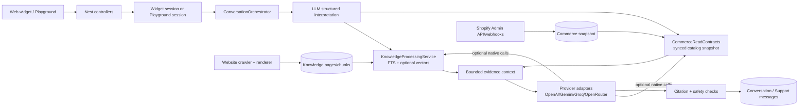
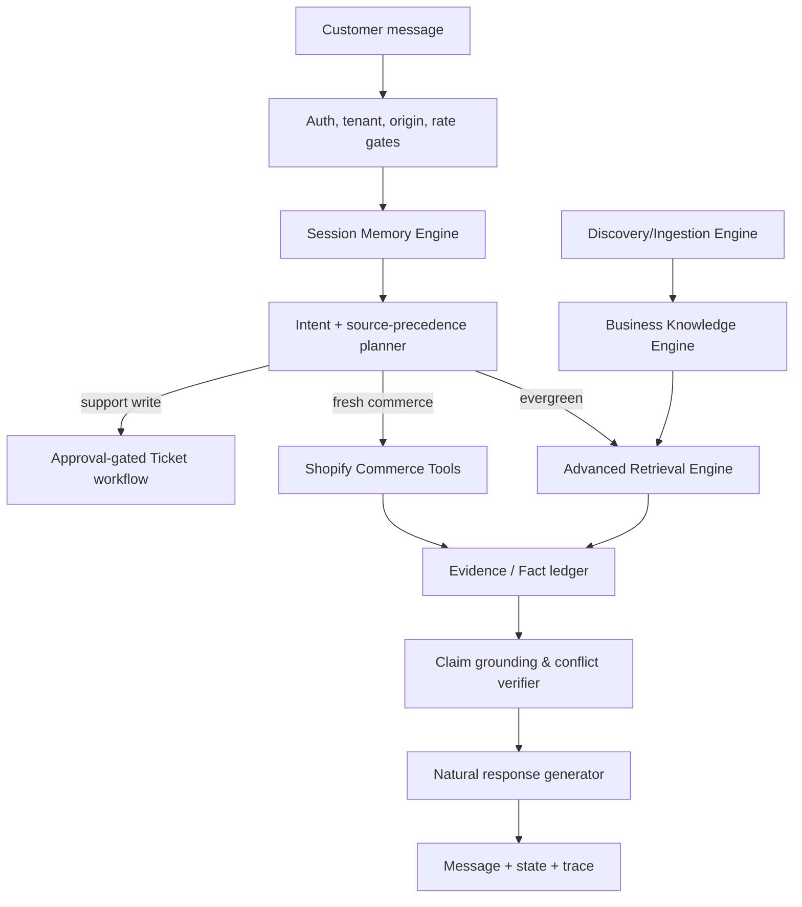

# CARTEIO AI — Intelligence Audit & Production Architecture Blueprint

**Audit date:** 18 October 2026  
**Scope:** source-code analysis only. No application, database, environment, network, Shopify, Noupe, or dependency change was made.  
**Evidence convention:** **Confirmed** is directly observable in the repository; **Risk/hypothesis** requires production traces or a controlled evaluation to confirm. Line references are current working-tree locations.

## 1. Executive summary

Carteio already has a serious security-and-grounding foundation, rather than a keyword bot: tenant-scoped Prisma queries, verified website gates, public-source eligibility, bounded website crawling, lexical plus optional vector retrieval, provider adapters, native LLM tool calls, citation validation, Shopify catalog sync, and ticket confirmation/72-hour expiry controls.

The principal quality issue is not an absence of LLMs. It is that the runtime mixes three partially overlapping paths—pre-retrieval, native tools, and a local synchronized commerce snapshot—without a single typed source-of-truth contract or a claim-level verifier. The assistant can retrieve evidence, but cannot prove that a generated price, stock assertion, compatibility statement, or multi-source conclusion is entailed by it. Shopify data available to the conversation is synchronized data, not a live per-question lookup. Website coverage and crawl health are tracked, but category coverage and extraction completeness are not sufficient to declare a site “understood.”

Implement P0 first: source authority/freshness contracts, required evidence for commerce claims, and per-turn durable diagnostic traces. Then make retrieval and ingestion measurable before increasing agent complexity. A native NestJS orchestrator remains the right choice; LangGraph.js is not justified until there are durable, resumable multi-step external workflows beyond the present two read tools and ticket confirmation.

## 2. Audit method and repository map

| Area | Implemented evidence | Assessment |
|---|---|---|
| Apps | `frontend/` is React/Vite dashboard and landing UI; `chatbot-widget/` and `frontend/public/widget.js` provide embed delivery | Confirmed |
| Backend | NestJS under `backend/src`; module wiring in `backend/src/app.module.ts` and `modules/workspaces/workspace.module.ts` | Confirmed |
| Data | PostgreSQL/Prisma schema in `backend/prisma/schema.prisma` | Confirmed |
| Chat | `ConversationOrchestrator`, provider adapters, playground and widget paths | Confirmed |
| Knowledge | source/base assignment, crawl jobs/pages/chunks, FTS and optional OpenAI embeddings | Confirmed |
| Shopify | OAuth, encrypted connector credential vault, GraphQL adapter, sync jobs/webhooks, normalized catalog/order tables | Confirmed |
| Tickets | draft/typed confirmation, outbox, retention worker | Confirmed |
| Noupe | No external live investigation was run; no private implementation is asserted | Explicit limitation |

Existing phase documents describe plans, but this report treats runtime paths and tests as evidence, not phase names.

## 3. Current architecture and message execution

### Actual customer turn

1. Widget configuration/domain/origin/session checks occur in `widget.service.ts` (notably lines 54, 103–155); widget calls `SaasService.recordCustomerMessage`.
2. `ConversationOrchestrator.processTrustedCustomerTurn` (same class as playground orchestration) resolves authorized organization/assistant/session and loads bounded recent turns. Playground has explicit ownership checks at `conversation-orchestrator.service.ts:~240–330`; persisted history is limited to 12 messages / 16 KiB at lines 1133–1147.
3. The model is asked for a constrained interpretation; server validators in `conversation-intent.ts:93` reject malformed outputs. Deterministic social messages may bypass retrieval.
4. `resolveConversationReference` only derives follow-up identifiers from prior **user** content (`conversation-context.ts:36–98`), intentionally refusing assistant-only identifiers.
5. `buildRetrievalQueryPlan` retains the original query and adds bounded validated variants (maximum eight; `retrieval-query-plan.ts:1–104`).
6. `KnowledgeProcessingService.searchPreview` applies organization, assistant assignment, public visibility, connector permission and active index filters; it runs FTS and optional vector search (`knowledge-processing.service.ts:~430–600`).
7. Commerce search is exposed to the LLM as `search_store_products`; knowledge search as `search_business_knowledge` (`conversation-orchestrator.service.ts:~902–990`). At most five tool executions and three reasoning rounds are allowed.
8. Evidence is deduplicated and capped (five items by default) in `knowledge-context-builder.ts:26–70`; provider input is capped at 96 KiB.
9. The answer must cite allowed evidence; stale/invalid authorization, uncited references, and personal-status claims have guarded fallbacks (`conversation-orchestrator.service.ts:1005–1034`).
10. The result and sources are saved to support/playground messages; ticket-linked widget history is filtered after ticket expiry (`widget.service.ts:150`).

### What is working correctly

- Tenant ownership is repeatedly part of query predicates; composite organization relations and source/assistant assignment are present in `schema.prisma`.
- Public chat source eligibility is restrictive, including `PUBLIC_REFERENCE`, ready state, base assignment, and connector permissions (`knowledge-processing.service.ts:~430–510`).
- The crawler respects same-host limits, robots, SSRF-safe address checks, size/time/page/depth caps, redirects and canonical normalization (`website-crawler.ts:31–164`, `377–525`).
- Crawl sync is idempotent and preserves prior pages where removal is not authoritative (`website-sync.ts:8–35`); jobs avoid duplicate active crawls (`knowledge-processing.service.ts:348–360`).
- The retrieval path supports lexical fallback when embeddings fail and never silently treats vector search as available.
- Citation identities are revalidated against active source versions before response delivery; the answer plan explicitly says `entailmentVerified: false` (`grounded-answer-plan.ts:135–169`).
- Shopify OAuth/connector configuration validates scopes/capabilities and credentials are vault-oriented; Shopify webhook events enqueue incremental jobs rather than trusting their bodies as final catalog state.
- Ticket creation uses a draft + typed confirmation pathway and ticket conversations have the requested 72-hour expiry behavior.

## 4. Website discovery and ingestion audit

### Current behavior

`WebsiteCrawler.crawl` starts from an authorized URL, fetches/parses `robots.txt`, honors the effective rules and delay, reads `/sitemap.xml` plus up to ten robots sitemap hints, walks sitemap indexes to depth two, and supplements with same-host anchors. It prioritizes policy/contact and Shopify collection/product URLs (`website-crawler.ts:363–525`). HTML extraction strips hidden/noise elements and favors main content; browser rendering is an extraction fallback (`extractWebsitePage`, lines 213–299). The worker persists pages, hashes/chunks content, tracks sync runs, validators, unchanged/removed pages, errors and freshness (`knowledge-processing.service.ts`).

### Confirmed limitations

| Current mechanism → failure mode | Evidence | Correct architecture / exact change | Test |
|---|---|---|---|
| Sitemap index depth 2, max 10 sitemap files, bounded page queue → legitimate deep/indexed inventory may be absent | `website-crawler.ts:428–449` | Persist a `DiscoveryManifest` with every attempted sitemap, reason/cap hit, URL count and category estimate. Mark coverage `PARTIAL_LIMITED`, not ready. Allow merchant-reviewed seed paths; never bypass robots. | Fixture with 3-level sitemap index; report missing branch and do not mark complete. |
| Link crawling only supplements bounded discovery → JS navigation / infinite-scroll content can be missed | lines 522–525; renderer is per-page extraction fallback | Add an approved renderer discovery mode that emits same-origin anchor URLs after rendering, with exactly the same robots/scope/limits. | SPA fixture exposes policy only after rendering. |
| Page category is URL/title heuristic → policy, FAQ, product facts can be misclassified | `classifyWebsitePage` line 250 | Store multi-label classification with confidence and extraction provenance; use structured JSON-LD and page headings before model classification. | “Delivery Information” page with opaque URL is tagged SHIPPING. |
| Pages are text-oriented chunks → product/variant relationships are not normalized from site pages | `extractHtmlPage`; char chunker in `knowledge-indexing.ts:45–77` | Add `ExtractedFact` / `ProductProjection` only for attributable structured data; retain source span and version. | JSON-LD Product with variants yields linked facts, no invented fields. |
| Crawl completion is strict but dashboard readiness is source-level | `complete` requires no failures/robots skips at line 524; `searchReady` is boolean in `knowledge-processing.service.ts:294` | Publish a coverage vector by category: discovered/fetched/parsed/indexed/failed/skipped/duplicate; readiness must be `READY_COMPLETE` or `READY_PARTIAL`. | One robots-blocked returns page produces `READY_PARTIAL` with reason. |

### Required ingestion status

`REGISTERED → AUTHORIZED → DISCOVERING → FETCHING → EXTRACTING → INDEXING → READY_COMPLETE | READY_PARTIAL | FAILED | PAUSED`.

Each run should expose: discovered, eligible, robots-skipped, duplicate/canonical-collapsed, fetched, HTTP failures by class, parsed, rendered, structured facts, chunks created/reused, indexed, category coverage, last known-good generation, and whether deletions are authoritative. “Trained” must never be the only status.

### Freshness

Website sources already expose manual/daily/weekly schedule, pause, `lastSuccessfulSyncAt`, validator fields and incremental reuse. Shopify sync/webhook infrastructure exists. Missing is a claim-facing freshness policy: responses must expose/obey an `asOf`, and product price/availability must not be served from website chunks where an authorized commerce source is expected.

## 5. RAG and retrieval audit

### Current mechanism

- Chunking: normalized fixed character chunks (2,800 chars, 240 overlap) with hash deduplication (`knowledge-indexing.ts:40–88`), not semantic/heading-aware chunking.
- Embeddings: optional OpenAI embedding provider; schema holds embedding profile/data. Lexical retrieval still works when embeddings are unavailable.
- Retrieval: PostgreSQL `websearch_to_tsquery`/`phraseto_tsquery` query plus optional semantic result merge in `searchPreview`; mandatory tenant, source version/generation, assistant/base, visibility and connector permission gates.
- Query rewriting: constrained interpretation-derived variants; no free-form replacement of the original.
- Context: top evidence selection is capped, diversified and de-duplicated.
- Validation: citations are identity-checked, but semantic entailment is explicitly not checked.

### Weakness matrix

| Current mechanism | Failure mode | Evidence | Proposed change | Verification |
|---|---|---|---|---|
| Character windows | A policy condition or product attribute is split from its qualifier | `chunkKnowledgeText` | Section-aware chunks: DOM heading path, FAQ Q/A atomic unit, product/variant atomic record, policy clause boundaries; preserve offsets. | “free delivery above ₹999” remains with eligibility condition. |
| FTS + optional vectors with bounded merge | Semantically relevant result can be dropped; lexical ranking favors boilerplate | `searchPreview` SQL | Candidate pools per modality (e.g. lexical 30 + vector 30), reciprocal-rank fusion, then lightweight reranker only on 20 candidates. | Recall@10 across policy/product fixtures exceeds current baseline. |
| Single generic evidence shape | Current price and stale web price are both prose context | `buildEvidenceContext` only special-cases Shopify policy authority | Introduce typed evidence: `commerce_live`, `commerce_snapshot`, `shopify_policy`, `website`, `merchant_faq`; each includes freshness and permitted claims. | Price answer refuses stale snapshot when live unavailable. |
| Five evidence items / 32 KiB | Multi-aspect question loses one required fact | `knowledge-context-builder.ts` | Aspect-to-evidence allocation: retrieve/rerank per aspect, require each answer aspect to map to evidence or be declared unknown. | Product-X + delivery threshold retrieves two sources. |
| Token matching “grounded plan” | Candidate evidence can share words but not entail conclusion | `grounded-answer-plan.ts:~85–169`, `entailmentVerified:false` | Add deterministic claim extractor for money/date/availability plus model verifier that can only label supported/unsupported/ambiguous against cited snippets. | Reject “delivery is free” if threshold/eligibility is absent. |
| No observed online reranker | Near-duplicate navigation/legal text consumes candidates | No reranker service found | Add optional cross-encoder/LLM rerank interface with offline benchmark gate; retain lexical fallback. | Duplicate pages do not displace return policy. |

The Product X example cannot be guaranteed today: it may retrieve price and delivery policy separately, but neither the candidate plan nor citation validation proves applicability (cart total, exclusions, destination) before the model says delivery is free.

## 6. Agent, memory, language, and naturalness audit

### Confirmed strengths

- Native provider tool definitions have server-side schema and allow-list checks, budgets, timeouts, and capability checks (`conversation-orchestrator.service.ts:902–990`).
- The system supports up to three tool/reasoning loops and five tool executions.
- Recent message continuity is durable for both playground and widget support conversations. Follow-up reference logic deliberately avoids treating prior assistant text as proof.
- Language interpretation/semantic validators and response-language selection exist; response style/tone/default language are modeled on `Chatbot`.

### Gaps and recommendations

| Finding | Classification | Severity | Fix location |
|---|---|---:|---|
| No separately persisted session state for selected products, constraints, customer corrections, language/tone preference, or workflow state | Confirmed—schema has messages/conversations but no such state model; bounded history only | High | Add `ConversationState` and `ConversationPreference` to Prisma; `SessionMemoryService`. |
| Only the last 12 messages / 16 KiB are used, with no summary | Confirmed (`conversation-orchestrator.service.ts:1133–1147`) | High | Summarize expired turns into server-validated state, never copy assistant claims as facts. |
| Product tool supports textual catalog search/browse but no typed constraint plan for color, price, availability, variant relation or sort | Confirmed tool interface (`~902–946`) | High | `CommerceQueryPlan` JSON schema, execution in `CommerceReadContracts`; SQL filter/variant join and source/as-of returned. |
| Tool selection is model-led after pre-routing; no deterministic policy selects authoritative live data for freshness-sensitive intents | Confirmed | High | Intent classifier produces non-authoritative capabilities; server source-precedence planner requires commerce live/snapshot for price/stock. |
| LLM output citation check does not verify individual factual claims | Confirmed | Critical | `GroundingVerificationService` P0. |
| Naturalness is constrained by several deterministic fallbacks; repetition detection exists but has no answer variation/repair strategy | Confirmed `isRepeatedUserRequest` / fallback paths | Medium | Add response planner: acknowledge correction, answer direct question first, cite naturally, ask only the minimum clarification. Do not add randomness. |

Use a native NestJS orchestrator. It already has the necessary stage model, timeout, persistence and tool authorization. Reconsider LangGraph.js only when workflows require durable pause/resume, compensation, human approval across multiple external writes, or graph visualization that exceeds a single transactional service.

### Memory design

| Layer | Retention / source | Rules |
|---|---|---|
| Recent turns | existing message tables | 12 turns for prompt; full transcript subject to current platform retention. |
| Session summary | new `ConversationState` | compact facts from customer messages + validated tool outputs only; versioned, expires with session. |
| Current references | new state fields | selected product/variant IDs, candidate set, filters, source versions; invalidate on catalog update. |
| Preferences | new opt-in `ConversationPreference` | language, concise/detail preference; scoped to assistant/visitor and configurable retention. Never infer sensitive traits. |
| Workflow state | ticket/workflow models | ticket state remains separate, explicit confirmation required. |
| Retrieved evidence | current turn only | revalidate on each answer; do not convert it into memory facts. |

Ticket-linked conversation and ephemeral memory must continue to expire after 72 hours. Do not apply that requirement to unrelated conversations without product/legal policy confirmation.

## 7. Shopify intelligence audit

The Shopify adapter uses Admin GraphQL, validates shop domains/API version, handles cursor pagination, scope/capability discovery, credential refresh and webhook-to-incremental-sync mapping (`connectors/shopify.adapter.ts`). Normalized `CommerceProduct`, variants and orders are stored through connector sync paths; `CommerceReadContracts` exposes catalog evidence to chat.

### Source-precedence policy required

1. **Live authorized Shopify read**: price, sale price, inventory/availability, current variants, customer order state. Required for a fresh claim when supported.
2. **Timestamped synchronized Shopify snapshot**: only when its freshness SLA for the requested attribute is met; reply says “last synced” when relevant.
3. **Shopify legal/store policy API**: policy answer where scope/capability exists.
4. **Merchant FAQ / website**: descriptive/evergreen facts; never overrides live commerce values.
5. **Unknown / unavailable**: direct limitation; no inference.

Current code has strong sync and permission mechanics, but no per-turn live product/order API tool. Therefore it must not claim “live” price or stock based solely on a snapshot. Customer-specific order access must remain independently authenticated/authorized; a visitor session is not proof of Shopify customer identity.

## 8. Confirmed root causes and unverified risks for wrong replies

| Layer | Symptom | Evidence / status | Impact | Remedy |
|---|---|---|---|---|
| C: storage | Website product/policy data largely persists as pages/chunks | Confirmed from crawler/chunker paths | loses structured relationships | typed facts/projections with provenance |
| D: retrieval | Relevant policy clause is absent or ranked below boilerplate | Confirmed fixed chunks + no reranker | incomplete/unrelated answers | section chunks + hybrid fusion/rerank |
| D/E | Multi-source conclusion asserted without applicability proof | Confirmed `entailmentVerified:false` | hallucinated eligibility/price logic | claim-level verifier + aspect coverage gate |
| F: tools | Cheapest/color/in-stock request is only text catalog search | Confirmed tool contract | wrong product selection | typed catalog query plan |
| F/J | Fresh facts can come from synchronized snapshot rather than live read | Confirmed no live chat tool found | stale price/stock claims | live commerce tool + freshness rule |
| I: memory | “Anything cheaper?” / “black color me?” can lose selected candidate after bounded history | Confirmed bounded 12-turn context, no state model | broken multi-turn conversation | session state + summary |
| E/G | Response can cite a relevant source yet state an unsupported conclusion | Confirmed citation identity only | false confidence | grounded-claim validation |
| A/B | Deep/JS pages can be absent while source appears ready | Confirmed bounded discovery + binary readiness | missing facts | coverage matrix/readiness levels |
| G | Hindi/Hinglish style and factual fidelity are not measured in production | Risk; validators exist but no benchmark result exists | inconsistent language quality | bilingual gold set and human scoring |
| J | Provider/tool failures are logged but not accumulated into a per-turn queryable trace | Confirmed logging is event-oriented | slow root-cause diagnosis | durable masked trace tables |

No cross-tenant leakage defect is confirmed by this audit. Isolation must still be regression-tested because it is security-critical.

## 9. Target production architecture

| Component | Status | Decision / responsibilities | NestJS/API/data contract |
|---|---|---|---|
| Discovery & ingestion | Exists | Improve, not replace. Manifest, category coverage, structured extraction, render-discovery, authoritative deletion. | `KnowledgeProcessingService`, `WebsiteCrawler`; `GET /knowledge/sources/:id/coverage`; `KnowledgeDiscoveryRun`, `KnowledgeCoverageMetric`. |
| Business knowledge | Exists | Improve typed, versioned facts while retaining chunks. | `KnowledgeFact`, `FactEvidence`, `ProductProjection`; every fact has org/source/version/span/asOf/authority. |
| Retrieval | Exists | Improve hybrid candidate fusion, rerank, aspect allocation and confidence. | `RetrievalService.retrieve(RetrievalRequest) -> EvidenceSet`; all filters server-owned. |
| Agent orchestrator | Exists | Improve planner and typed tools; retain native NestJS. | `ConversationOrchestrator`, `SourcePrecedencePlanner`, `ToolExecutor`. |
| Session memory | Partial | Add state/summary/preferences, expirations and invalidation. | `SessionMemoryService`; state is never evidence. |
| Shopify tools | Partial | Add authorized live read adapters, retain sync for search/latency fallback. | `ShopifyCommerceReadTool`; returns authority/freshness/completeness. |
| Grounding | Partial | Add claim extraction/entailment/conflict gate, retain citation revalidation. | `GroundingVerificationService.verify(Draft, EvidenceSet)`. |
| Natural generator | Partial | Keep provider adapters; pass response plan, language and facts, not raw undifferentiated chunks. | structured response: answer, citations, unknowns, clarification. |
| Observability/evaluation | Partial | Persist masked stage telemetry and run gold-suite regression. | `ConversationTrace`, `RetrievalTrace`, `ToolTrace`, `EvaluationRun`. |

Security boundaries: all IDs are organization-and-assistant scoped; the model can propose tool calls but server selects capability, arguments schema, authority and output redaction; only write workflows require explicit approval. Do not store raw secrets, full prompts, full visitor identity, access tokens, or unrestricted tool output in trace data. Cost/performance: cache authorization and static embeddings, batch embeddings, use hybrid retrieval before optional rerank, cap candidates/context, and reserve live Shopify reads for freshness-required intents.

## 10. Exact implementation blueprint

### P0 — Accuracy and security foundations

**Objective:** make every customer-facing factual claim attributable to an authorized, current source.

| Change | Existing files affected | New files / DB | Acceptance |
|---|---|---|---|
| Typed evidence authority/freshness | `conversation-orchestrator.service.ts`, `knowledge-context-builder.ts`, `commerce-read-contracts.service.ts` | `source-authority.ts`, Prisma migration for `asOf`, `freshUntil`, `completeness` | Price/stock cannot be answered from website evidence when commerce authority is required. |
| Claim verifier | `grounded-answer-plan.ts`, `response-safety.ts` | `grounding-verification.service.ts` | Unsupported monetary/date/availability claim yields qualified answer, not model text. |
| Durable traces | orchestrator, provider/tool paths | `ConversationTrace`, `RetrievalTrace`, `ToolTrace` migration/service | One request ID shows first failed stage without raw prompt/token persistence. |
| Cross-tenant guards | existing service tests | adversarial fixture tests | all retrieval/tool/state queries reject foreign org/assistant IDs. |

Steps: (1) define `EvidenceAuthority` and claim freshness rules; (2) emit typed evidence from knowledge/commerce; (3) make response planner declare requested claim types; (4) require a matching authority and non-expired evidence; (5) validate citations plus claim support; (6) retain current safe fallback; (7) add deterministic tests before enabling for widget.

**Risks/backward compatibility:** launch in shadow/audit mode, compare rejection rate, then enforce on price/stock/order categories first. Preserve existing citation source display and fallback message contracts.

### P1 — Website knowledge and advanced RAG

**Objective:** know whether content was covered and retrieve the right evidence per aspect.

Affected: `website-crawler.ts`, `knowledge-processing.service.ts`, `knowledge-indexing.ts`, `website-sync.ts`, `knowledge-context-builder.ts`. New: `website-discovery-manifest.ts`, `structured-fact-extractor.ts`, `hybrid-retrieval.service.ts`, `reranker.interface.ts`; migrations for discovery/coverage/fact tables.

Steps: persist manifest; produce category coverage; implement heading/FAQ/product-aware chunks; add JSON-LD extraction; fuse lexical/vector candidate pools; evaluate reranking; allocate context per aspect; expose coverage API/UI. Do not erase existing chunks until a new index generation is complete and validated.

Acceptance: partial crawl is visibly partial; gold retrieval recall@10 is measured; a two-fact question retrieves both facts; old active generation stays searchable during reindex.

### P2 — Agent brain and natural conversation

Affected: `conversation-orchestrator.service.ts`, `conversation-context.ts`, `conversation-intent.ts`, `widget.service.ts`. New: `source-precedence-planner.ts`, `session-memory.service.ts`, `commerce-query-plan.ts`, Prisma state/preferences migration.

Steps: persist validated user constraints and selected IDs; summarize only user/tool facts; make a server source planner; add typed product filters/sort; give generator a concise response plan; invalidate state on catalog/source version change. Maintain 72-hour ticket memory expiry.

Acceptance: the four-turn running-shoe example retains price/color/product reference across refresh within retention; ambiguous reference asks one question; no assistant-created identifier becomes fact.

### P3 — Shopify commerce intelligence

Affected: `connectors/shopify.adapter.ts`, `commerce-read-contracts.service.ts`, connector sync worker, scope docs/tests. New: `shopify-live-commerce.service.ts` and capability-specific tool contracts.

Steps: require scope/capability freshness; implement minimal read-only live product/variant/availability tools; attach `asOf` and completeness; use sync snapshot only under SLA; keep webhooks for cache invalidation/incremental sync. Customer order operations require separate identity proof and explicit merchant approval.

Acceptance: current price/inventory answer is live or explicitly timestamped/unavailable; variant filtering is correct; Shopify failures produce an honest limitation.

### P4 — observability, evaluation, optimization

Affected: `intelligence-evaluation.ts`, datasets, structured logging middleware, dashboard APIs. New: `observability/` services and evaluation run storage.

Acceptance: releases have baseline vs candidate report, p50/p95 latency, cost estimate, retrieval diagnostics, and no unresolved critical/high deterministic case.

## 11. Noupe-quality benchmark and evaluation plan

Do not claim a Noupe comparison until the same authorized public test domain, question set, source snapshots and manual rubric are used. No paid/live test was executed for this audit.

### 60-case minimum dataset (use merchant-specific answer keys, not the placeholders below)

| # | Category | Customer prompt / scenario |
|---:|---|---|
|1–4|Facts|What does this store sell?; Where are you based?; Contact email?; Business hours?|
|5–8|Products|Show running shoes; Compare A and B; Which is lightest?; Does X have size 9?|
|9–12|Filters|Black shoes under ₹2,000; cheapest available option; vegan products; gifts under ₹1,000|
|13–16|Price/stock|Price of X?; sale price?; in stock in blue?; when restocked?|
|17–20|Delivery|Free delivery threshold?; Product X delivery eligibility?; delivery time Pune?; COD availability?|
|21–24|Returns|Return window?; return worn item?; refund processing time?; exchange policy?|
|25–28|Multi-source|X + free delivery?; compare price + warranty; product compatible with Y?; offer + policy conflict|
|29–32|Hindi|“₹2000 ke under shoes”; “return kitne din mein?”; “black wala available hai?”; “delivery free hogi?”|
|33–36|Hinglish|“Iska size 8 milega?”; “kuch cheaper dikhao”; “iski return policy kya hai?”; “COD hai kya?”|
|37–40|Follow-up|Shoes → cheaper → black → “iski policy?”|
|41–44|Corrections/refresh|“No, not Product A”; language switch; reopen session; repeat a question after update|
|45–48|Unknown/OOS|Ask unsupported feature; unavailable product; missing policy; out-of-scope general advice|
|49–52|Reliability|Embedding unavailable; Shopify 429; live API timeout; stale snapshot|
|53–56|Security|Tenant A asks Tenant B fact; prompt injection in a page; assistant instruction override; assistant-only ID follow-up|
|57–60|Tickets/orders|Complaint draft; reject draft; typed confirmation; order status without customer authorization|

For every case store: permitted source snapshot/version, expected facts/unknowns, valid source authority, expected tool(s), expected language, citation requirements, and whether human review is required.

Metrics: coverage (discovered/fetched/parsed/indexed by category); retrieval recall@k and MRR; fact/claim precision and unsupported-claim rate; correct tool/source selection; multi-turn state resolution; language rubric; median/P95 end-to-end and tool latency; input/output tokens and estimated cost/conversation. Current baseline is **not measured**; obtain it from a non-production fixture run before declaring targets. Suggested release targets after baseline: 100% critical authorization tests, 0 unsupported factual claims in critical gold cases, ≥95% correct authoritative-source selection, ≥90% retrieval recall@10 on answerable cases, and measurable p95/cost budgets agreed with product.

## 12. Observability design

Persist a small allowlisted `ConversationTrace` per request: request/org/assistant/channel hashed session ID, model route, normalized language/intent labels, source plan, counts/ranks/authority/freshness (not raw chunk text), tool name/outcome/latency, grounding decision/reason, fallback, timings, token figures where provider supplies them. `RetrievalTrace` should have source/chunk IDs, rank, score components and selected/dropped reason. `ToolTrace` stores validated argument class/size or hash, never raw private data.

The first failed stage is the earliest non-success among `SECURITY_CONTEXT`, `SESSION_RESOLUTION`, `INTERPRETATION`, `RETRIEVAL`, `TOOL_EXECUTION`, `ANSWER_GENERATION`, `RESPONSE_VERIFICATION`, `PERSISTENCE`. Existing JSON stage logs (`ConversationOrchestrator.beginStage`, lines ~133–180) are a useful starting point but are not a queryable causal record.

## 13. Security, cost, performance, and manual approvals

- Maintain robots, authorization, domain verification, SSRF, origin, tenant and capability gates. Do not add crawler bypasses.
- Redact PII and secrets from traces; hash visitor/session correlation keys; tenant-restrict trace views.
- Add rate limits/circuit breakers for embeddings, rerankers and Shopify reads; cache only appropriately scoped, freshness-bounded read results.
- Review Shopify scopes and merchant consent before enabling any live data tool. No order/customer action should be inferred from chat text.
- Approve retention schedules, opt-in preference policy, live API budget, selected embedding/reranking models, and benchmark domain/test-account access before implementation.

## 14. Top ten improvements and first implementation recommendation

1. Enforce typed authority/freshness for price, stock, order and policy claims.
2. Add claim-level grounding verification.
3. Persist masked per-turn traces.
4. Separate structured product/policy facts from raw web chunks.
5. Publish page/category coverage and partial-ingestion status.
6. Upgrade to section-aware chunking and hybrid fusion.
7. Add typed product constraint planning and variant-aware catalog retrieval.
8. Add durable session state/summary with safe invalidation.
9. Add authorized read-only live Shopify tools.
10. Gate releases with the bilingual, multi-turn, adversarial gold suite.

**Implement first:** P0 authority/freshness + claim verification + traces. It addresses the highest-risk incorrect answer mode without changing crawler coverage, provider choice, or merchant-facing configuration.

### P0 first-file checklist

- `backend/src/modules/workspaces/conversation-orchestrator.service.ts`
- `backend/src/modules/workspaces/knowledge-context-builder.ts`
- `backend/src/modules/workspaces/grounded-answer-plan.ts`
- `backend/src/modules/workspaces/response-safety.ts`
- `backend/src/modules/workspaces/connectors/commerce-read-contracts.service.ts`
- `backend/prisma/schema.prisma` plus a new migration
- New `backend/src/modules/workspaces/grounding-verification.service.ts`
- New `backend/src/modules/workspaces/observability/*`
- Existing/new unit and integration tests under `backend/test/`

## 15. Risks to existing functionality and regression checklist

Claim gates can increase honest “I can’t confirm” replies initially; measure rather than suppress them. Keep current citation display, fallback strings, source assignment semantics, idempotency, ticket confirmation and public/private visibility behavior stable. Regression checklist: auth/org isolation; allowed widget origins; crawl robots and redirects; active-generation search; embedding-unavailable lexical retrieval; provider fallback; citation rejection; ticket 72-hour purge; Shopify scope loss/webhook dedupe; product/variant ordering; Hindi/Hinglish follow-ups; request timeout/idempotency.

## 16. Final conclusion

Carteio’s correct foundation should be preserved: NestJS, Prisma/PostgreSQL, current widget/session controls, source authorization, crawler safety, provider adapters, native tool calling, Shopify sync, and ticket safeguards. The next task should implement P0 only, behind feature flags and with fixture-based tests. It should not begin a broad rewrite or add LangGraph/microservices before the measurable grounding and source-authority problems are solved.
