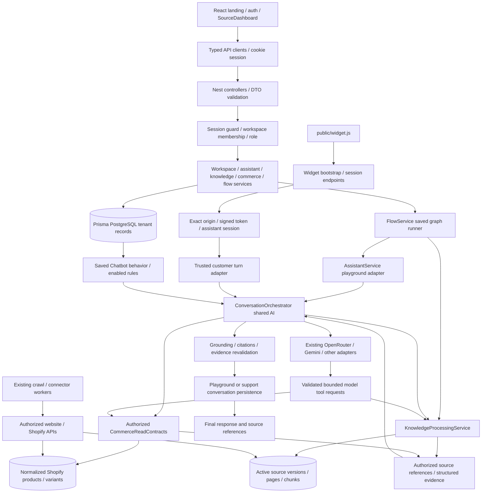

# Phase 00 architecture baseline

Observed on 2026-10-24, branch `uat`, HEAD `3928901f24aad1f82919c10b901dd03b32b0535b`. This describes the working tree, including pre-existing uncommitted files, rather than HEAD alone. Runtime evidence and limitations are recorded in [phase-00-verification.md](phase-00-verification.md). Earlier phase/audit documents are historical context, not proof of this baseline.

## Executable applications and tooling

The pnpm workspace contains `frontend`, `backend`, and `packages/shared-types`. The root pins pnpm 9.15.0 and Node >=24.11.0 <25; the observed Linux runtime is Node 24.15.0. `infrastructure/renderer` is a separate optional renderer package; `frontend/public/widget.js` is the shipped browser widget. `integrations/wordpress` contains integration artifacts. These are not replacement conversation engines.

Root `test` and `typecheck` invoke Prisma generation. Backend `dev`/`build` also generate the client. Phase 00 invokes installed Jest/Vitest entry points directly and does not run these scripts. See [regression-protection.md](regression-protection.md).

## Active frontend composition

`frontend/src/main.tsx` mounts the React application. `src/routes/AppRoutes.tsx` selects public/auth/workspace routes. Authentication, theme, and workspace state come from `src/app/providers`. The active workspace shell is `layouts/DashboardLayout/DashboardLayout.tsx`, which loads `dashboard-source/SourceDashboard.tsx`. Its `pageFromPath` and `pages.tsx` switch select the actual dashboard pages.

| Route | Active component/path |
|---|---|
| `/` | `pages/landing/LandingPage.tsx` in PublicLayout |
| `/features`, `/integrations`, `/how-it-works` | Redirects to landing anchors |
| `/docs`, `/help` | InfoPage placeholders, not a documentation/support service |
| `/login`, `/signup`, `/forgot-password`, `/reset-password`, `/verify-email` | AuthPages/AuthLayout |
| `/platform-admin` | SaasPages.PlatformAdminPage behind RequireAuth |
| `/onboarding`, `/workspaces`, `/dashboard` | OnboardingPage, WorkspaceSelectorPage, WorkspaceEntry |
| `/workspace/:slug` | SourceDashboard Overview |
| `.../assistants`, `.../assistants/:id` | pages.tsx Assistants |
| `.../training`, `.../training/behavior`, `.../training/playground` | pages.tsx Train, Behavior, Playground |
| `.../knowledge`, `.../knowledge/:id` | pages.tsx Knowledge, SourceDetail |
| `.../crawler`, `.../crawler/:id` | pages.tsx Crawler, CrawlDetail |
| `.../products`, `.../products/item?externalId=...&integrationId=...` | Products, ProductDetail |
| `.../sales`, `.../orders/:id` | Sales, OrderDetail |
| `.../builder` | pages.tsx Builder -> dashboard-source/ChatflowBuilder |
| `.../integrations`, `.../integrations/shopify`, `.../integrations/shopify/:id`, `.../integrations/shopify/sync` | Integrations, Shopify, Sync; ShopifyPermissionsPanel is shared |
| `.../widget`, `.../widget/appearance` | Install, Appearance |
| `.../conversations`, `.../tickets`, `.../tickets/:id` | Conversations, Handoff, CaseDetail |
| `.../escalation-rules`, `.../analytics`, `.../billing`, `.../invoices` | HandoffRules, Analytics, Billing, Invoices; some controls are explicit unavailable placeholders |
| `.../settings`, `.../team`, `.../settings/team` | SettingsPage, Team |

`SourceDashboard` handles the wildcard route manually; unknown workspace suffixes currently fall back to overview. Components under legacy `pages/assistants`, `pages/training`, `pages/knowledge`, `pages/flows`, and `pages/saas` may still exist and have tests, but are not automatically active routes. The active page imports must be checked before treating a legacy component test as dashboard coverage. Shared ShopifyPermissionsPanel and training copy/export helpers are imported by the active dashboard.

`services/api/client.ts` is the authenticated browser transport. It owns the `/api/v1` prefix, cookies, response/error parsing, timeouts, cancellation and stream handling. Domain clients are `auth`, `workspaces`, `assistants`, `knowledge`, `knowledge-bases`, `connectors`, `flows`, `widget`, `saas`, and `dashboard`. AuthProvider loads `/auth/me`; WorkspaceProvider loads authorized memberships, clears old account data on identity changes, and stores only the last workspace slug as a preference. DashboardLayout resolves the chosen workspace through the backend before showing its content. Workspace authorization remains a backend decision.

## Backend registration and request paths

`backend/src/main.ts` validates configuration, installs request IDs, structured logging, validation/error/CORS/CSRF controls, and the API prefix. `AppModule.register(databaseEnabled)` registers Health, Database, Auth and Workspace modules; authenticated workspace routes are absent in deliberate no-database mode. A running UI alone therefore does not prove API availability.

WorkspaceModule registers Workspace, Assistant, Flow, Knowledge, AssistantKnowledge, KnowledgeBase, SaaS, ShopifyOAuth, connector webhook, platform operator, and Widget controllers. AuthModule has AuthController and guards. DatabaseModule supplies PrismaService using the existing PostgreSQL/Neon adapter. No real database was queried in Phase 00.

Session-authenticated controllers use AuthSessionGuard. Services call `WorkspaceService.requireAccess(userId, slug, allowedRoles)` and constrain rows by organization and assistant. OWNER/ADMIN membership checks protect manager operations. Widget/public endpoints instead validate exact origins and signed session credentials. OAuth callbacks and webhook routes use their respective state/HMAC checks, not a dashboard cookie as their sole authorization.

Worker arrows describe implemented ingestion, not Phase 00 activity. No worker, sync, or crawler was started.

## Conversation execution

AssistantService delegates Playground requests to ConversationOrchestrator. WidgetService routes public visitor messages through SaaS/customer turn execution into `processTrustedCustomerTurn` and the shared AI path. Context identity and persistence adapters differ by channel; the interpretation, retrieval, provider and validation implementation is shared.

The orchestrator authorizes the assistant, resolves/locks the session, loads bounded history, assembles saved behavior, interprets semantic intent, retrieves eligible knowledge, exposes permitted read tools, calls the configured provider, executes bounded validated tool calls, and sends returned evidence back in the provider context. Answer validation checks references and selected structured claims, revalidates source versions/permissions, and persists the final message. Its deterministic grounding checks explicitly do not prove arbitrary prose entailment. Stage diagnostics record actual attempts and supplied evidence; an eligible-source count is not a retrieval-match count.

`conversation-provider.service.ts` retains OpenRouter, Gemini, Groq and OpenAI adapters; effective provider/model comes from existing server configuration. Native tool protocols are implemented for supported routes. Compatibility retries and owner-approved fallback routes exist; mocks do not establish live model compatibility.

Bot Behavior is persisted on Chatbot plus AssistantBusinessRule. `assistant-behavior-context.ts` serializes the saved name, purpose, description, instructions, language, tone/style, greeting, fallback and escalation as a lower-priority instruction layer. `callSelectedProvider` inserts this layer into outbound messages. `assistant-contact-evidence.ts` supplies separately validated configuration contact evidence; general instructions do not become factual evidence or permissions.

## Knowledge and Shopify

KnowledgeService manages source lifecycle and assignment. KnowledgeBaseService manages collections and assistant links. KnowledgeProcessingService resolves effective access, enforces PUBLIC_VISITOR visibility, current source version/active generation and authorized origins, retrieves lexical/optional semantic candidates, and revalidates cited chunks. Automatic workspace knowledge access is an explicit assistant policy, not a tenant bypass.

WebsiteCrawler, website renderer/sync helpers, WebsiteVerificationService and the dedicated knowledge worker implement SSRF/DNS boundaries, extraction, jobs, chunk indexing and publication. Semantic retrieval is conditional on `KNOWLEDGE_SEMANTIC_ENABLED`, the supported embedding profile, credentials and usable indexed vectors. Source implements lexical fallback and diagnostic unavailability codes. Actual deployment configuration/vector state remains unverified; no embedding request was sent.

ShopifyOAuthService and granted-scope discovery feed ConnectorInstance/IntegrationConnection. ConnectorSyncWorker and ShopifyConnectorAdapter normalize products/variants, orders, and approved content. Workspace and assistant data permissions are separate. CommerceReadContracts applies connection/scope/capability/permission checks and masks unauthorized price/inventory/category fields. `search_store_products` uses this normalized snapshot, not a live stock promise. Collection membership is a product attribute. Order reads have an operator-only backend contract; no anonymous customer order tool exists. Additional scope-authorized store content reaches AI through eligible knowledge ingestion, not a dedicated tool for every scope.

## Agent Builder boundary

FlowController offers list/create/get/update/delete and `POST :flowId/run`. FlowDefinition stores versioned JSON nodes, tuple edges and stable handle metadata; updates use expectedVersion concurrency. FlowService validates a bounded DAG and executes start, transform, assistant, condition, knowledge and response nodes for an authorized manager. Assistant nodes call the existing Playground path; knowledge nodes return INTERNAL_MANAGER_PREVIEW results in run diagnostics, while the following assistant performs its own public retrieval. They do not inject those preview results into the assistant prompt.

There is no published flow version model or publish route, no WidgetConfiguration flow reference, and no widget-to-FlowService execution path. Multiple sequential assistant nodes do not establish a supervisor or parallel multi-agent runtime. `recordStep` advances `context.current` after transform/assistant execution; the existing execution/branching suite passed in the baseline. An initial suspicion of missing value propagation was ruled out by this source path and the test evidence.

## Database relationships (source schema, not deployed-schema verification)

| Parent/entity | Related records and boundary |
|---|---|
| User | PasswordCredential, AuthIdentity, UserSession, verification/reset/OTP tokens; OrganizationMembership joins users to workspaces |
| Organization | Tenant root for Chatbot, KnowledgeSource/Base, integrations, products/orders, conversations, flows, widget records, subscriptions and audit records |
| OrganizationMembership | User + organization uniqueness; ACTIVE membership and OWNER/ADMIN/MEMBER roles |
| Chatbot | Assistant configuration/behavior, AssistantBusinessRule, knowledge links, connector AI permissions, conversations and FlowDefinition |
| KnowledgeSource | KnowledgePage, KnowledgeChunk, processing jobs/sync runs; sourceVersion + activeIndexGeneration select published evidence |
| KnowledgeBase | KnowledgeBaseSource joins sources; AssistantKnowledgeBase joins assistants; AssistantKnowledgeSource supports direct links |
| ConnectorInstance | Encrypted ConnectorCredential, workspace/assistant data permissions, sync jobs/schedules/webhooks, IntegrationConnection |
| IntegrationConnection | Granted Shopify scopes and verification time, CommerceProduct/Variant, CommerceOrder/Line and sync state |
| PlaygroundConversation | Organization + assistant + manager user + channel; ordered PlaygroundMessage, turn idempotency and active request lock |
| SupportConversation | Organization + assistant + visitor/customer/channel; SupportMessage, tickets/drafts and outbound delivery records |
| WidgetConfiguration / WidgetSession | One configuration per assistant; exact allowed domain, appearance; origin/token/visitor/assistant/conversation binding |
| FlowDefinition | Organization + assistant, graph JSON and optimistic version; no publish/version-history entity |
| WorkflowExecution / Step / Approval | Existing generic action bookkeeping; not proof that graph publishing or supervisor execution is connected |
| WorkspaceSubscription / UsageLedger / PlatformOperator | Existing SaaS billing/usage and platform administration; provider payment lifecycle is not proved by UI fields |

Composite tenant foreign keys and organization-scoped queries are protection mechanisms, not proof of the deployed database state. Phase 00 makes no schema, migration, provider, or production behavior changes.

## Phase 00 stabilization update — 2026-10-26

The backend source and focused fixes described in [known defects](known-defects.md) include guarded internal conversation notes, grounding-date validation, retrieval/context normalization, knowledge response projection, widget session handling, and validation-message safety. Backend suite evidence is offline and mocked; live provider, merchant database, and Shopify operations remain unverified. Frontend has saved failures and source-only edits pending execution, so the architecture baseline is not a production-readiness claim.
