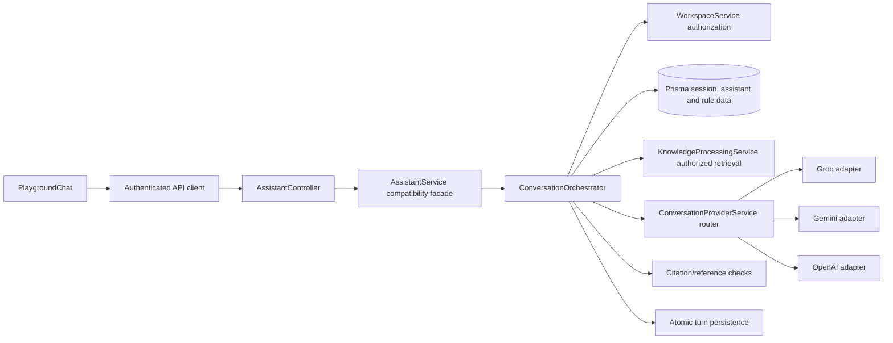

# Phase 09A — Conversation Architecture

## Scope and current boundary

The authenticated Playground route remains `AssistantController`. It receives a validated DTO and passes the session user, route workspace slug, assistant ID, request correlation ID, and disconnect signal to `AssistantService`. The service remains the compatibility facade used by existing callers. It delegates chat turns and session-history reads to `ConversationOrchestrator`.

`ConversationOrchestrator` is the one coordinator for a Playground turn. It does not implement provider HTTP formats or source authorization itself. It resolves the workspace membership and assistant under that workspace, runs the existing social fast path, selects the assistant's configured provider policy, calls the existing provider router, requests search through `KnowledgeProcessingService`, validates supplied citation references, and commits through the existing durable session/message tables.

## Audit findings from the pre-extraction implementation

- `AssistantController` was already thin and guarded by `AuthSessionGuard`; it already converted request disconnects into an `AbortSignal`.
- `AssistantService` combined assistant CRUD/training history with a roughly 200-line conversation method and its session/rate/idempotency persistence helpers. That was the primary responsibility-boundary problem.
- Workspace access was checked before the assistant lookup, which included the authorized organization ID. This order is preserved.
- Effective Knowledge source resolution and the public retrieval predicate were already centralized in `KnowledgeProcessingService`; this security boundary is preserved.
- Provider wire formats were already normalized in `ConversationProviderService` for Groq, Gemini and OpenAI. The orchestrator continues to use that router.
- AUTO_FALLBACK backup eligibility read provider-key environment variables directly inside `AssistantService`. This is now routed through `ConversationProviderService.isProviderConfigured`.
- The frontend supplied a 55-second chat timeout while each provider request could independently use up to 25 seconds. A multi-stage turn therefore had no shared deadline. The orchestrator now gives each turn a 52-second monotonic deadline and passes the remaining budget to each bounded provider call.
- Durable session ownership, client-turn replay, the active-request lease, rate limits and paired-message transaction already existed. They were moved with the execution coordinator rather than replaced.

## Responsibilities and dependency direction

- `AssistantController`: HTTP route, session guard boundary, request/response disconnect cancellation.
- `AssistantService`: assistant CRUD, training settings/history and backward-compatible delegation for Playground methods.
- `ConversationOrchestrator`: execution order and response assembly for one authenticated Playground turn.
- `ConversationProviderService`: server-side provider key lookup, provider/model adapters, normalized output, provider failure categories and configuration status.
- `KnowledgeProcessingService`: assistant-effective source resolution, source visibility/status/workspace predicates, and search.
- Prisma models: durable conversation ownership, ordering, idempotency and lock leases; no new schema was added for 09A.
- `conversation.contracts.ts`: server-created authorized context, lifecycle stage/outcome vocabulary, safe evidence shape and internal error taxonomy.
- `conversation-intent.ts`: existing bounded deterministic social classification and validated interpretation parsing, extracted as pure functions.

No user-controlled workspace ID, source ID, role, or provider override becomes an authorization source. The orchestrator derives organization scope from `WorkspaceService.requireAccess`; source eligibility remains inside the retrieval resolver/query. Provider secrets remain server-side in `ConversationProviderService`.

## Trust and evidence boundaries

Platform/security controls and server authorization outrank owner configuration, assistant behavior, factual Knowledge, and user input. Knowledge excerpts are serialized as reference data and treated as untrusted instructions. The model only receives results returned by authorized public retrieval. Its `[S#]` references are checked against evidence for the current turn before source metadata is returned. This membership check does not prove full claim entailment; stricter factual consistency is later Phase 09F work.

The public customer-style Playground search uses `PUBLIC_VISITOR`. `KnowledgeProcessingService` continues to constrain effective assistant sources by workspace, assistant direct/base links, ready/active/non-archived status, and public visibility. No knowledge permissions were relaxed.

## Provider and routing boundary

The router retains Groq, Gemini and OpenAI adapters behind `ConversationProviderService`. Assistant settings choose the primary provider/model. `MANUAL` remains the default. Existing explicit `AUTO_FALLBACK` routes are honored only for transient provider failures and after the first selected provider attempt; Knowledge misses and citation failures do not trigger provider fallback. The orchestrator uses `isProviderConfigured` for backup eligibility rather than reading environment variables itself.

No live provider call was performed for 09A. Adapter format and error handling remain in the existing adapter service and are covered by its existing focused tests, whose execution status is recorded separately.

## Sessions, deadlines and diagnostics

Session ownership, expiry, sequence allocation, `clientTurnId` replay, active request lease, rate limiting and atomic paired-message persistence were moved with the coordinator from `AssistantService` without changing their database contract. The controller's abort signal is forwarded through the selected provider call. The coordinator now applies a 52-second monotonic turn deadline and caps each provider call at the existing 25-second maximum, passing the remaining turn budget to the adapter. The frontend chat timeout remains 55 seconds. Exactly-once external provider execution is not guaranteed after uncertain network completion; durable duplicate replay remains keyed to the existing turn identifier.

`ConversationStageEvent` uses uppercase lifecycle outcomes and carries correlation ID, tenant/assistant identifiers, channel, stage, duration, and bounded result/provider metadata. `ConversationOrchestrator.runStage` emits one STARTED event and one terminal event; caught failures are categorized safely and rethrown. The deterministic intent stage uses the same one-start/one-terminal helper. Replay and no-evidence paths emit COMPLETED-with-reason or SKIPPED events where appropriate. Events contain no message, prompt, evidence excerpt or credentials. Provider adapter diagnostics continue to own upstream status/finish-reason details.

## Extensibility and limits

`ConversationChannel` includes a future `PUBLIC_WIDGET` value as a policy seam only. No widget route, public identity, tool execution, live business integration, crawler or document ingestion is implemented. Future channel authorization must be established by server routing before creating the trusted conversation context. Phase 09D/09E must address the observed Hinglish-to-English retrieval gap; this refactor does not claim cross-language retrieval is solved.

## Requirement-to-code completion audit (final source pass)

| Requirement | Classification | Source evidence and boundary |
|---|---|---|
| One authenticated Playground turn path | COMPLETE AND SOURCE-VERIFIED | `AssistantController` → `AssistantService.playgroundChat` → `ConversationOrchestrator.playgroundChat`; controller has no separate turn logic. This is structural evidence, not runtime verification. |
| Workspace membership before assistant lookup | COMPLETE AND SOURCE-VERIFIED | Orchestrator calls `WorkspaceService.requireAccess` and scopes assistant lookup to the returned organization. |
| Typed turn and stage contracts | COMPLETE IN SOURCE | `PlaygroundTurnRequest`, trusted context, and `ConversationStageContracts` define explicit input/output and success/failure states for security, session, history context, provider routing, intent, retrieval, evidence, answer, verification, and persistence. Runtime behavior still requires typecheck and focused tests. |
| One shared backend deadline and bounded provider stages | IMPLEMENTED BUT UNVERIFIED | One monotonic deadline is constructed for the turn; each provider attempt gets min(25s, remaining). Explicit checks stop expired/cancelled work before provider calls and persistence. Prisma operations are not forcibly cancelled. |
| Cancellation propagation | IMPLEMENTED BUT UNVERIFIED | Controller signal reaches provider adapter; orchestrator checks cancellation after provider returns and before persistence. Other database reads may complete after disconnect, but cannot save a late answer through the turn persistence helper. |
| Session ownership and ordering | COMPLETE AND SOURCE-VERIFIED | Session lookup, lease, release and history query include tenant, assistant and user. A 90-second active lease serializes turns; one transaction persists adjacent user/assistant rows and increments sequence. |
| Duplicate turn replay | PARTIALLY IMPLEMENTED | Stable `clientTurnId` replay returns the committed pair; a unique index prevents duplicate rows. Frontend supplies the ID. If a caller omits it, backend generates a fresh ID, so an uncertain retry is not idempotent. Request ID is correlation, not durable idempotency. |
| Provider selection and approved fallback | COMPLETE AND SOURCE-VERIFIED | Assistant settings select primary route; MANUAL remains default. AUTO_FALLBACK uses configured backup routes only for transient provider errors and configured credentials. |
| Authorized evidence retrieval | COMPLETE AND SOURCE-VERIFIED | `KnowledgeProcessingService` resolves linked assistant/base source IDs and SQL rechecks tenant, active registration, READY state, current version/generation, and visibility. Public visitor mode filters to `PUBLIC_REFERENCE`. |
| Citation/reference validation | PARTIALLY IMPLEMENTED | `[S#]` references must be supplied for this turn; invalid or absent citations produce configured safe fallback. Entailment is not established (Phase 09F). |
| Safe provider errors | COMPLETE AND SOURCE-VERIFIED | Adapters map upstream failures to stable application codes without returning raw provider bodies or credentials. |
| Structured safe diagnostics | COMPLETE IN SOURCE; RUNTIME UNVERIFIED | Applicable stage operations emit structured STARTED and terminal outcomes with duration and safe error categories. Security denial before tenant resolution carries a null organization ID because no authorized tenant is known. Events omit message and prompt content. |
| Knowledge processing lease fencing | COMPLETE AND SOURCE-VERIFIED | New chunks, active-generation publication, READY state, and job completion occur in one transaction. Completion uses `updateMany` fenced by job ID, PROCESSING status, and lease owner; loss rolls back publication. |
| Crawler ingestion in 09A | DEFERRED TO ANOTHER PHASE | Worker rejects website processing; parser remains separately unit-tested. Product ingestion stays deferred as requested. |
| Adaptive RAG, entailment verification, long-term memory, widget/tools | DEFERRED TO ANOTHER PHASE | Later 09E/09F/09G and channel/tool phases; no such behavior is claimed here. |

### Final completion boundary

The canonical architecture and security boundaries are present in source. Phase 09A is **not runtime-verified or ready for closure** until Windows Jest/Vitest, typecheck, Prisma status, and browser checks pass. The supplied backend failure summary did not include full failure output, and tests could not be executed under the explicit execution restrictions. No Phase 09B work is included.

The final foundation implementation adds typed per-stage contracts and connects the typed stage runner to the executed security, session, context, provider selection, retrieval, evidence, answer, verification and persistence operations. Intent interpretation has a matching typed contract and emits its lifecycle through a single guarded start/finish scope. Focused Playground regression tests assert successful stage coverage, safe authorization failure diagnostics, duration/correlation fields, and absence of raw customer message content. These assertions are source-only until run on Windows.
