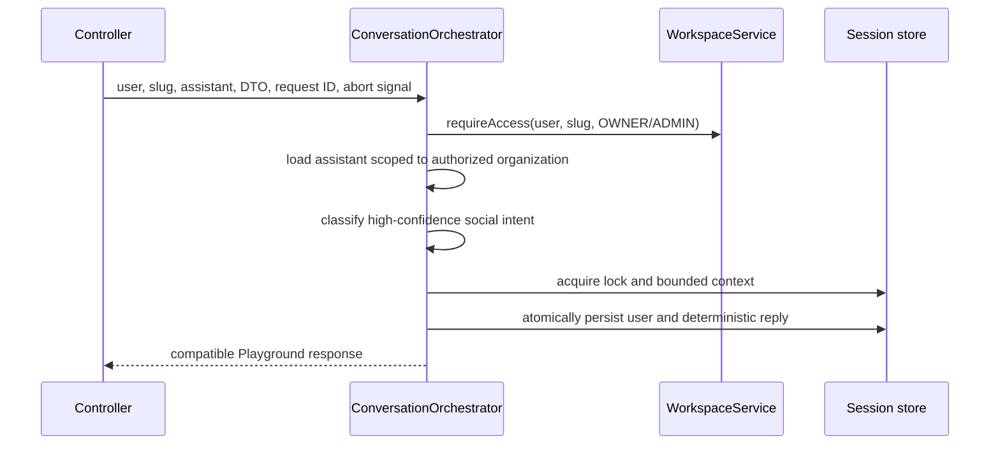
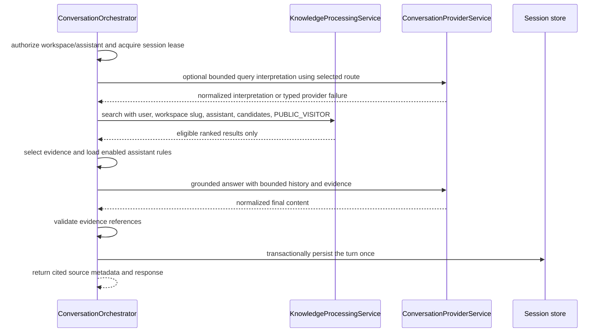
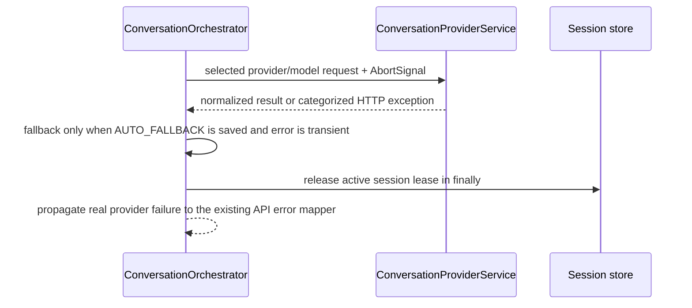

# Phase 09A — Request Lifecycle

The sequences below document the implemented Playground contract. Provider/model orchestration and authorized retrieval remain in existing services; the orchestrator coordinates their order.

## Greeting fast path

Greeting shortcuts remain limited to the existing deterministic set and only apply when the whole message is social. A greeting with a business question proceeds through retrieval.

## Grounded business question

## Missing Knowledge

The same authorized search is performed. If no public-ready linked source is eligible, the response indicates setup is needed. If sources are eligible but no relevant result is returned, the saved assistant fallback is used. Neither case is converted into a provider error, and neither causes automatic provider fallback.

## Provider failure

Provider failures are not persisted as business answers. A provider completion that is received but fails citation checks continues to use the existing safe configured fallback behavior.

## Browser timeout and retry

The frontend sends the existing stable `clientTurnId`; retry of the same message reuses the ID. The backend first looks up a committed user/assistant pair in the requested owned session and returns it when present. The per-session lease prevents concurrent turns from committing out of order. A server-created monotonic 52-second deadline bounds total provider work; individual provider calls remain capped at 25 seconds and receive the remaining budget. The frontend retains its 55-second chat timeout. A disconnect signal is forwarded to provider HTTP work; a request whose external provider result is uncertain may still have incurred provider cost. The durable application state is idempotent for an already committed turn, but exactly-once provider execution cannot be guaranteed across a network failure before commit.

## Unauthorized request

The controller requires an authenticated session. The orchestrator resolves workspace membership and only then loads the assistant using the resolved organization ID. Session reads and writes include organization, assistant, user and channel ownership predicates. Knowledge source scope is resolved by `KnowledgeProcessingService`; model output cannot add source IDs or change tenant scope.

## Deadline and disconnect checks

The server creates one monotonic deadline when it has established the authorized assistant context. Provider calls receive the smaller of the remaining turn budget and 25 seconds. The coordinator checks the same deadline and request signal before provider work, after provider work, and immediately before turn persistence. The adapter aborts its fetch on either its local timeout or the controller disconnect signal. A late provider result after cancellation or deadline is discarded and cannot be committed by the persistence helper. Prisma reads and transactions do not accept this signal, so an already-running database operation may finish; lease predicates and transaction boundaries still govern durable writes.

## Typed stage boundaries and diagnostics

`ConversationStageContracts` associates each stage name with an input and output type, plus a discriminated `{ ok: true } | { ok: false }` result contract. Each input carries `AuthorizedConversationContext` directly or through the session/provider context, so organization, assistant, user, channel, and request correlation remain present across trust boundaries. The orchestrator's typed `runStage` accepts only the input and output associated with that stage and rethrows operation failures after recording them.

The ten stage names are SECURITY_CONTEXT, SESSION_RESOLUTION, CONVERSATION_CONTEXT, PROVIDER_SELECTION, INTENT_INTERPRETATION, KNOWLEDGE_RETRIEVAL, EVIDENCE_SELECTION, ANSWER_GENERATION, RESPONSE_VERIFICATION, and TURN_PERSISTENCE. Executed stages emit uppercase STARTED and one terminal outcome with `durationMs`; terminal outcomes distinguish COMPLETED, FAILED, CANCELLED, and TIMED_OUT. Replay is a completed session-resolution outcome with a safe reason. When no eligible evidence exists, answer generation and response verification are explicitly SKIPPED. A workspace authorization rejection may have a null organization ID because the server has not established a trusted tenant yet.

Lifecycle event fields are limited to request/tenant/assistant/channel/stage IDs, duration, safe error category, approved provider/model, counts, and bounded reason codes. They do not include the message, prompt payload, evidence excerpts, credentials, or authentication headers.

## Completion status

- **Complete in source:** Ten typed stage contracts and consistent stage event structure are wired into the canonical Playground path.
- **Implemented but runtime unverified:** Stage outcomes, provider selection metadata, failure categories, cancellation/deadline behavior, and replay/skip diagnostics have focused source assertions but have not been executed.
- **Deferred:** Adaptive retrieval and multilingual ranking changes, claim entailment checks, long-term memory, and public widget/tool execution remain later-phase work.
